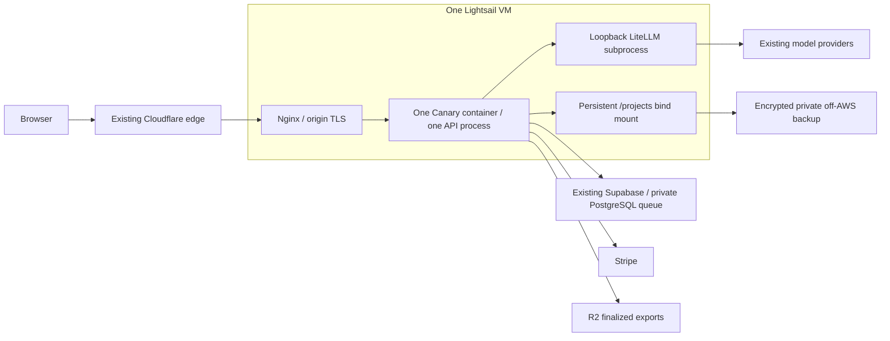

# Fly to AWS: Lightsail migration design

**Status: Proposed. Researched October 6, 2026. No infrastructure deployed.**

## Recommendation

Use one Linux Lightsail **virtual server**, initially `medium_3_0` in
`us-east-1`: 2 vCPUs, 4 GB RAM, 80 GB SSD, public IPv4, 4 TB monthly transfer,
**US$24/month**. Keep the existing Docker application, Cloudflare edge,
Supabase auth/database/private queue, Stripe, PostHog, and R2 export delivery.
Use Nginx on the host for origin TLS and reverse proxying. Build images outside
production. Target **US$30–40/month for hosting and its backups** after credits.

Lightsail is the best initial AWS fit for the checked-in workload and budget.
It is not a measured performance improvement over Fly, nor a high-availability
design. It exchanges Fly's platform management for responsibility for Linux,
Docker, TLS, backups, disk capacity, and recovery. Credits alone do not justify
a move if that operational work cannot be maintained.

Choose EC2 instead if sustained CPU demand, instance-profile credentials,
advanced networking, or a larger machine selection becomes necessary. Avoid
long-term commitments while demand is unknown. A standard container and data
backup must remain sufficient to leave AWS.

## Evidence and credit status

Read-only AWS calls on October 6 confirmed:

- `FreeTier.GetAccountPlanState`: account plan is **PAID / ACTIVE**, remaining
  credits **US$199.98**. This account can incur charges beyond its credits.
- `Lightsail.GetBundles`, `us-east-1`: the recommended bundle is active at
  $24; the 8 GB general-purpose bundle is $44. An IPv6-only 4 GB bundle is $20,
  but saving $4 is not worth introducing unverified provider/registry IPv6
  compatibility into this migration.
- `Pricing.GetProducts`: Linux/shared/on-demand N. Virginia rates are
  $0.0376/hour for `t3a.medium`, $0.0416/hour for `t3.medium`, and $0.0336/hour
  for ARM `t4g.medium`. Regional gp3 storage is $0.08/GB-month.
- `Billing.GetCredits` was denied with **“IAM user access not activated.”**
  The grant name, exact expiration date, and applicable products remain
  unverified. No account permissions were changed.

The user subsequently supplied the displayed expiry `10/02/2027`; the month/day
interpretation is pending confirmation. This is user-supplied console evidence,
not a successful `GetCredits` lookup. Service eligibility is still unverified.

AWS's [Free Tier FAQ](https://aws.amazon.com/free/free-tier-faqs/) says these
credits expire **12 months from account creation**, not from today or from
migration. Other promotional grants follow their own
[terms and eligible services](https://aws.amazon.com/awscredits/).
Before provisioning, inspect [Billing → Credits](https://console.aws.amazon.com/billing/home#/credits)
for this grant's date and explicit Lightsail eligibility. Alternatively, the
account owner can enable IAM billing access and permit `billing:GetCredits`.
Do not infer October 2027 from the user's recollection or the remaining balance.
Do not join a new AWS Organization merely to implement cost controls: the
Free Tier FAQ says that doing so expires these Free Tier credits immediately.

The repository review used executable configuration and code, including
`fly.toml`, `Dockerfile`, `litellm/entrypoint.sh`, `server/app.py`,
`server/durable_queue.py`, and `server/ratelimit.py` under the Python source
root. The earlier [deployment review](deployment-platform-review.md) supports
the single-owner limitation, but is stale about the queue and release workflow:
the [deploy runbook](../deploy.md#step-1b--generation-queue-database) records
private Supabase queue provisioning on September 27, while
`.github/workflows/ci.yml` is absent in this checkout. Its described pipeline
must not be treated as available automation.

No live Fly bill, workload metrics, disk usage, deployed version, Supabase plan,
or existing backup success was inspected. These are implementation inputs, not
facts established by this design.

## Service comparison and cost model

USD before tax; 730 hours/month for EC2 examples. EC2 figures include 80 GB gp3
and one IPv4 at [$0.005/hour](https://aws.amazon.com/vpc/pricing/).
AWS API prices above take precedence over region-ambiguous marketing tables.

| Option | Monthly baseline | Fit for Canary |
|---|---:|---|
| Lightsail VM, 4 GB | $24.00 | Recommended; disk/IP/transfer bundled |
| EC2 `t3a.medium`, x86 | $37.50 | Viable portable VM, little budget left for backups and transfer |
| EC2 `t3.medium`, x86 | $40.42 | Already exceeds the target before backups/transfer |
| EC2 `t4g.medium`, ARM | $34.58 | Needs image/Chromium/Prisma ARM validation; modest saving over x86 |
| ECS on EC2 | Underlying EC2 plus operational components | Does not solve single-owner application coordination |
| ECS Fargate | Roughly $72.08 compute-only for 2 vCPU/4 GB | Poor budget fit before persistent storage and networking |
| Lightsail Container Service / App Runner | No deployment quote selected | Managed container hosting does not preserve the current local-volume contract without redesign |
| Lambda | No deployment quote selected | Substantial rewrite of long-running queue, local artifacts, and streaming lifecycle |

The Fargate illustration uses AWS's published
[per-vCPU and per-GB example rates](https://aws.amazon.com/blogs/aws-cloud-financial-management/a-finops-guide-to-comparing-containers-and-serverless-functions-for-compute/);
it is not a deployment quote. Lambda's standard
[15-minute invocation limit](https://docs.aws.amazon.com/lambda/latest/dg/configuration-timeout.html)
also conflicts with the configured two-hour batch lifecycle; newer execution
models do not make this application a drop-in Lambda deployment.

Proposed operating allowance:

| Item | Monthly planning allowance |
|---|---:|
| Lightsail VM | $24 |
| Incremental snapshot storage | $4–6 |
| AWS monitoring/operational contingency | $2–5 |
| Private off-AWS backup storage/requests | $1–5 |
| Total | **$31–40** |

The variable rows are **allowances, not enforced caps or measured bills**.
At [$0.05/GB-month](https://docs.aws.amazon.com/lightsail/latest/userguide/amazon-lightsail-faq-snapshots.html),
$4 represents 80 GB of billable snapshot data. Snapshot churn can exceed that;
neither seven snapshots nor an 80 GB disk guarantees an 80 GB snapshot bill.
Measure retention and archive sizes before accepting this envelope.
Supabase, existing edge/observability subscriptions, model providers, domain
renewal, payment fees, taxes, and temporary Fly overlap are additional existing
or migration costs. If $40 must cover the entire product, inventory these first.

Assuming the grant covers the whole AWS portion, no other AWS spend, and no
earlier expiry, $199.98 funds **6.67 months at $30/month** or **5.71 months at
$35/month**. At $40/month it funds 5 months. It does not fund a year of this
hosting. At $30/month AWS spend, first-year usage less this credit is $160.02,
before off-AWS costs/tax. All calculations were executed in Python through the
AWS tool. Bedrock or unrelated AWS usage can consume the same credit balance.

## Proposed architecture

1. **Compute:** maintained Ubuntu LTS base, Docker, pinned OCI image digest,
   Nginx. Host `/srv/canary/projects` binds to `/projects`; it survives container
   replacements. Keep one API process and the existing five generation tasks
   initially, subject to load validation. Keep LiteLLM on container loopback.
   Publish port 8000 to host loopback only; do not publish 4000 or databases.
2. **Edge:** retain Cloudflare DNS and Full (strict) TLS. Attach a static IPv4.
   Accept public 443 only from Cloudflare source networks and constrain origin
   access to this site with authenticated origin requests. SSH is limited to
   approved admin/deploy sources. An origin certificate is acceptable while
   Cloudflare remains in front; document replacement with a public certificate
   as part of leaving Cloudflare. Track certificate expiry and CIDR updates.
3. **Proxy correctness:** Nginx must validate the Cloudflare peer, replace
   client-supplied forwarding headers, and forward the validated visitor IP.
   Trust only the actual Nginx peer in Uvicorn. The current non-Fly rate limiter
   consumes `request.client`, which Uvicorn's trusted-proxy middleware already
   rewrites. Verify that complete path with Nginx and distinct visitors rather
   than assuming a new rate-limit implementation is necessary. Do not fake
   `FLY_APP_NAME` or trust arbitrary `CF-Connecting-IP`. Preserve secure cookies,
   request limits, SSE heartbeats,
   unbuffered event streaming, and suitable read timeouts. Never cache private
   API, author sources, or authenticated images at the edge.
4. **Database:** keep the current Supabase app/auth data and private queue
   schema. Verify the production connection target and region; use TLS and a
   direct or session-pooler connection, not transaction pooling. Do not copy the
   local Compose PostgreSQL services into production or introduce RDS just to
   spend the credit. Inventory any separate runtime gateway database dependency.
5. **Secrets:** follow the [secret migration and runtime design](aws-secret-management.md):
   SOPS/age-encrypted production bundles, host-local decryption into tmpfs,
   read-only file mounts, and a bootstrap loader preserving existing environment
   names. Use separate host and off-AWS recovery identities; CI deploys ciphertext
   without a decryption key. Preserve Vertex ADC delivery and keep PostHog's
   private build key in BuildKit. Full host snapshots contain the host key and
   must be treated as credential-bearing. Inventory, encrypted Fly extraction,
   rotation, reboot, and recovery gates are specified in the linked design.
6. **Recovery:** preserve `/projects/.ops/recovery.json` and the entrypoint's
   crash budget. Use bounded systemd supervision with Docker restart disabled
   so there is one restart authority. Persist an explicit maintenance hold
   across host boots. Verify intentional stop, crash, and budget-exhaustion
   behavior. Monitor `/api/health` separately from `/api/health/ready`; dependency
   failure must not create a restart storm. Rotate container/host logs.
7. **Delivery:** restore a release workflow with source-SHA checks, image build
   and smoke test before drain, serialized deploys, pinned digest rollback, and
   authenticated drain/verify/resume. A private OCI registry such as GHCR keeps
   deployment portable; verify its actual account allowance and authentication
   before choosing it. No CodePipeline, NAT gateway, ALB, EKS, or managed database
   is needed for this initial layout.

## Performance and scaling gates

Matching RAM/vCPU labels is not a benchmark. The $24 Lightsail plan has a
[20% CPU baseline](https://docs.aws.amazon.com/lightsail/latest/userguide/baseline-cpu-performance.html)
and accumulated burst capacity. Sustained export work may exhaust bursts and
reduce performance. EC2 T instances are also burstable; unlimited mode adds
surplus CPU charges. Use Standard mode if choosing EC2 with CPU-charge
predictability as the priority, accepting throttling when credits run out.

Before cutover, compare Fly and the candidate using the same sanitized project
fixtures, cached/provider-stubbed work, and region. Proposed acceptance targets:

- No OOMs, stable queue heartbeat, peak RAM below 80%, disk below 70% after image
  and data restore, with enough free space for rollback images and export temp files.
- Same-load p95 ordinary API latency and PDF/CBZ duration within 20% of the Fly
  baseline; SSE remains connected during exports and admission still works.
- Representative repeated exports plus concurrent readers do not steadily
  exhaust CPU burst capacity. Run long enough to avoid mistaking initial launch
  burst credits for sustainable capacity.
- Queued operations survive clean replacement, drain/resume works, and an
  interrupted paid request stays conservative rather than being resubmitted.

These are proposed gates, not observed results. No paid generation is required
for the infrastructure rehearsal. Provider quality is outside this check.

Scale memory vertically if RAM pressure persists after concurrency control;
the 8 GB plan costs $44 before backups, so exceeds the agreed target and needs
a budget decision. For CPU pressure, compare current compute-optimized Lightsail
and EC2 sustained performance instead of buying RAM blindly. Upsizing uses a
snapshot/new instance and controlled ownership handoff, not transparent autoscale.

Horizontal scaling needs application work first: distributed admission and
per-project mutation locks, shared artifact authority, durable event delivery,
separate queue execution lifecycle, and cross-host drain/lease fencing. The
current `flock` protects one filesystem; two copied volumes do not fence each
other. A load balancer or additional Uvicorn worker cannot safely solve this.
Keep PostgreSQL and a provider-neutral object-storage interface if that future
redesign is justified. Do not replace the queue with SQS or filesystem operations
with S3 during the hosting move.

## Preventing surprise charges

AWS Paid accounts have **no universal hard dollar cutoff**. AWS explicitly
documents [budget notification delays](https://docs.aws.amazon.com/cost-management/latest/userguide/budgets-managing-costs.html).
Budgets and budget actions cannot guarantee a maximum invoice.

- Set an account-wide gross-usage budget excluding credits/refunds, with alerts
  at $25/$30/$35 and a forecast above $35; track net payable charges separately.
  Verify alert delivery. Monitor remaining credits and their expiry, including
  other AWS services, rather than treating a $0 invoice as $0 consumption.
- Restrict routine deployment credentials to the named resources and intended
  region. No resource creation from runtime credentials. Reserve provisioning
  and size changes for an operator-reviewed plan; audit new resources.
- Keep one fixed VM, no autoscaling and no commitments. Basic support initially.
  Do not add a NAT gateway, load balancer, CloudFront, or Route 53 migration
  without a new cost justification.
- Monitor transfer daily and forecast month-end usage. At 50% of allowance,
  inspect the trend; at 75%, reduce unnecessary origin delivery; at 90%, apply
  an incident policy to restrict bulk downloads/abusive clients while preserving
  recovery. Include model-image downloads and backup traffic: both inbound and
  outbound consume the [Lightsail allowance](https://aws.amazon.com/lightsail/pricing/),
  with outbound overage billable. Rate controls help but are not a billing cap.
- Apply disk quotas/admission watermarks, bounded logs, image pruning, and
  explicit snapshot/archive retention. Never delete paid-result recovery data,
  journals, or active artifacts to satisfy a storage threshold automatically.
- Alert on provider spend separately. Application credits and five workers are
  not a hard provider budget. Preserve paid-call authorization and the existing
  narrowly approved fallback behavior; migration adds no retry policy.
- A spend incident should first stop new generation and expensive delivery,
  preserve recovery data, and notify an operator. **Stopping Lightsail does not
  stop its VM charges**; [deletion is required](https://docs.aws.amazon.com/lightsail/latest/userguide/amazon-lightsail-frequently-asked-questions-faq-billing-and-account-management.html).
  Retained snapshots and other resources keep billing. Do not automatically
  delete production data to enforce a budget.

## Backup, migration, rollback, and exit

Target an initial disaster RPO of 24 hours and RTO of 4 hours, subject to a
timed restore drill. This single-host design permits maintenance downtime and
cannot promise uninterrupted service after a host/AZ failure. If those targets
are insufficient, redesign availability and budget before migration.

Use daily Lightsail snapshots (the service retains seven automatic snapshots)
plus encrypted application-consistent backups to a **private** off-AWS bucket
or repository. Propose 14 daily and four weekly application recovery points,
subject to measured storage cost. R2 public exports are not a recovery backup.
Preserve complete `/projects`, SQLite journal/WAL consistency, `.jobs`, outbox,
recovery state, configuration, and database recovery coordinates. Follow the
[backup restore contract](../ops/backup-restore.md); pair database and file
recovery points and reconcile mismatches without automatic paid-call replay.

1. **Inventory and qualify.** Confirm grant eligibility/date, actual Fly costs,
   live resource/secret names, disk/image size, Supabase region/backup facilities,
   gateway dependencies, and performance baseline. Choose N. Virginia unless
   measurements or residency requirements favor another supported region.
2. **Prepare implementation.** Add the production Compose manifest, Nginx
   configuration, bounded supervisor/maintenance hold, portable secret delivery,
   backup/restore scripts, proxy trust tests, and replacement release workflow.
   Keep infrastructure definitions isolated from application code; use a small
   reviewed OpenTofu configuration for the VM/IP/firewall if useful. Store state
   securely and prevent routine replacement/deletion of production data.
3. **Rehearse in isolation.** Restore sanitized data into a disposable target
   with isolated database/queue and stubbed providers. An active candidate must
   never consume the production queue while Fly owns it. Exercise exports,
   health/readiness, auth isolation, streaming, stop/crash recovery, backup
   restore, forged-IP rejection, and release rollback.
4. **Make a consistent cutover.** Build/pull the tested image first. Put the
   public site into maintenance for all mutations, including lettering/metadata,
   not just generation. Handle Stripe webhooks through a deliberate pause/retry
   procedure with event reconciliation. Authenticated drain must report both
   `draining: true` and `safe_to_deploy: true`; queued work may remain queued.
   Stop the Fly application, take a final consistent copy and database recovery
   point, transfer all hidden files/permissions, and verify checksums. A live
   pre-copy only accelerates this final stopped copy; it is not the backup.
5. **Switch ownership once.** Keep Fly stopped and fenced from public writes.
   Start AWS drained with the same queue and copied artifacts, verify readiness
   and release SHA, then switch the Cloudflare origin. Check login, project
   isolation, assets, SSE, export, and webhook delivery. Resume deliberately
   after the checks. Never run two consumers against divergent project copies.
6. **Observe and retire.** Observe a complete workload/backup cycle, preferably
   48–72 hours. Keep Fly rollback data for a fixed seven-day window, price this
   overlap in advance, and then remove old resources only after restore proof
   and an explicit retirement decision. Retained Fly volumes may still bill.

**Rollback before AWS accepts writes:** stop/fence AWS, switch the origin back,
start the unchanged Fly copy, verify, and resume. **Rollback after AWS accepts
writes:** maintenance and drain on AWS, stop it, reverse-transfer the newest
complete artifact/journal state to Fly, reconcile the unchanged external queue
and billing events, then switch/resume. DNS reversal alone would lose state.
Do not restore an old database over a live Stripe credit ledger casually.

**Leaving AWS:** provision a Linux VM elsewhere, pull the same OCI digest,
restore the portable encrypted files and documented secrets, retain or migrate
PostgreSQL separately, and repeat the single-owner cutover. Test this using an
ordinary Linux environment; AWS snapshots alone are not portability proof.
AWS also supports [Lightsail snapshot export to EC2](https://docs.aws.amazon.com/lightsail/latest/userguide/amazon-lightsail-faq-export-to-ec2.html),
but that is a convenience for growth inside AWS, not an exit strategy.

## Verification of this proposal

Completed: repository/configuration review; official AWS pricing/behavior
research; read-only account-plan, bundle, and regional EC2/gp3 price API checks;
scripted cost arithmetic. Exact credit detail access remains blocked by the
account's billing access setting. No servers were started, resources provisioned,
deployments changed, secrets moved, or paid model requests made.

Implementation acceptance requires targeted proxy-trust, durable queue,
deployment/recovery tests and the candidate performance/restore exercises above.
Documentation validation alone does not establish production readiness.
