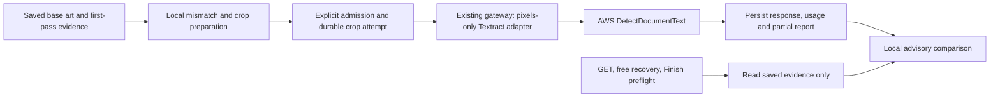

# Textract second-pass OCR exploration

**Follow-up, October 7, 2026:** The user confirmed that promotional credits cover
Textract and approved Canary absorbing the fee. An opt-in implementation now
exists; see the [current contract](../reference/textract-ocr.md). No live OCR
quality result or production activation is claimed. The original exploration
below is retained as decision history; its integration pause and unverified
credit eligibility are superseded by that authorization. Expiry and actual
credit allocation remain unverified.

**Original status: Proposed design, October 7, 2026 (America/Toronto).** Code inspection
at `0e30374d`, current official documentation, and read-only AWS/console evidence.
No Textract image submission, adapter implementation, deployment, IAM/billing
change, or production enablement occurred. Calculations below were executed
with Python `Decimal`; they are scenarios, not measured usage.

## Recommendation

**Proceed to a bounded accuracy pilot; do not commit to production integration
until its results justify it.** Use synchronous `DetectDocumentText` on PNG crops.
For production, prefer a typed Textract adapter behind the existing gateway,
with admission, artifacts, attempts, and settlement owned by the existing Canary
process. A standalone SDK harness is the smallest useful first implementation.

The proposed accuracy pilot is **100 requests / US$0.15 gross OCR cost**.
The expected recurring scenario is **US$6.12/month for 10,000 generated pages**,
assuming 20% need two crops and explicitly requested repeat attempts add 2%.
Production work, including the harness, evaluation, credentials and verification,
is estimated at **10.5–18 engineering days**, subject to the assumptions below.

**Promotional-credit verdict: UNVERIFIED.** The connected production account has
a reported US$199.65 account-plan credit balance, but both available routes to
grant details failed. Neither the eligible-products list nor the expiry is known.
Budget gross cost until this is resolved. Actual Textract credit allocation has
not been observed.

## Evidence and capability limits

The [Lightsail benchmark](../reviews/2026-10-07-ocr-lightsail-benchmark.md)
already establishes the local Paddle candidate's throughput problem: at a
simulated 0.4-vCPU entitlement, first-crop latency was 36.81 seconds and warm
median latency 10.89 seconds. Multi-crop/concurrent checks missed budgets.
There were no measured OOM events. Three successful English captions do not
establish general accuracy; those measurements are not Textract results.

Canary's [localization implementation](../../novel_to_comic/src/novel_to_comic/localization.py)
currently permits English, Spanish and French generation. All three are within
Textract's six documented printed-text languages (also German, Italian and
Portuguese). Handwriting is English-only; vertical text is unsupported, and
documented minimum character height is 15 pixels. Supported language is not
evidence of accuracy on decorative comic lettering. Do not expand this feature
to arbitrary future languages without evaluation.
[AWS input limits](https://docs.aws.amazon.com/textract/latest/dg/limits-document.html).

AWS describes synchronous detection as near real time, without establishing
Canary median/p95 latency. The API returns PAGE/LINE/WORD blocks, geometry and
`DetectDocumentTextModelVersion`. It accepts image bytes without an S3/SNS job.
[Processing model](https://docs.aws.amazon.com/textract/latest/dg/sync.html),
[DetectDocumentText](https://docs.aws.amazon.com/textract/latest/APIReference/API_DetectDocumentText.html).

Keep the [crop experiment](../reference/crop-ocr-experiment.md) and
[stage contracts](../reference/stage-contracts.md): integrated and retained baked
editions only; saved base art; six crops/page, three million pixels/crop,
24 million pixels/source page; advisory evidence. Hybrid's unwanted-lettering
check stays separate. Neither agreement nor disagreement verifies visual quality
or resolves author decisions. Missing-only findings without a region cannot
produce a close-up read. First-pass false negatives are outside the mismatch
trigger's reach and must be measured with correct-looking controls.

## Account and promotional-credit audit

Audit began at **2026-10-07 08:45 EDT / 12:45 UTC**. Full account identifiers and
private billing exports are intentionally absent from this document.

| Read-only evidence | Result |
| --- | --- |
| `STS.GetCallerIdentity` | Connected IAM user, account ending **3859** |
| `Lightsail.GetInstance(canary-prod)`, `us-east-1` | Running `medium_3_0`; ARN account suffix also **3859** |
| Intended submitting account | Same production account; future pilot/adapter must verify its own credential identity before submitting |
| `FreeTier.GetAccountPlanState` | `PAID / ACTIVE`, `accountPlanRemainingCredits` **199.65 USD** |
| `Billing.GetCredits` | **AccessDeniedException: IAM user access not activated** |
| Request period | `2025-10-08` through `2026-10-07`, no future end date, account-specific; no payer aggregation requested |
| Existing console session | Same account suffix; Billing home shows access denied on cost widgets; Credits fails to load grant information |

The Credits page displayed: “Something went wrong while redeeming your credit.
Try again at a later time, or contact {link}”. This occurred both through the
handoff link and the console's own Credits navigation. **No redemption was
attempted.** The UI error is recorded as an access/data limitation, not proof of
its underlying cause. No permissions, account plan, sharing settings or
Organizations configuration were changed.

Preserve the [October 6 historical evidence](aws-lightsail-migration.md#evidence-and-credit-status):
US$199.98 and the same API denial. Today's US$199.65 is an account-plan balance,
not a retrieved grant's `remainingAmount` or `estimatedAmount`. Do not infer the
grant type from the Free Tier API's name or from Lightsail coverage.

Still required from an owner-accessible grant record: name/description and type;
enabled status; effective and expiry dates; remaining and estimated balances;
the exact **Amazon Textract** applicable-product entry; purchase restrictions;
and account/sharing scope covering the submitting identity. `estimatedAmount`
includes open bills. The supplied expiry `10/02/2027` remains ambiguous; neither
`2027-02-10` nor `2027-10-02` has been established. Resolve the grant timestamp to
ISO format. Missing applicable-product data means unknown coverage.
[GetCredits](https://docs.aws.amazon.com/aws-cost-management/latest/APIReference/API_billing_GetCredits.html),
[CreditData](https://docs.aws.amazon.com/aws-cost-management/latest/APIReference/API_billing_CreditData.html).

Public terms limit credits to designated services and exclude taxes. Eligibility,
available balance after other usage, and actual billing allocation are distinct.
After a separately authorized pilot, inspect the bill/allocation when usage
appears; a free-tier zero charge is not proof of a promotional offset. Never
create a charge just to test coverage. If a relay is selected later, verify
Lambda, endpoint, logging and receipt-storage eligibility independently.
[Promotional terms](https://aws.amazon.com/awscredits/),
[Credit application](https://docs.aws.amazon.com/awsaccountbilling/latest/aboutv2/useconsolidatedbilling-credits.html).

## Architecture choice

| Candidate | Assessment |
| --- | --- |
| Direct SDK in existing analysis/job process | Smallest transport change and best for an isolated pilot. Production would place AWS provider credentials in the upload-serving process, changing the deliberate process boundary; would still need all admission, attempt and accounting work below. Not the preferred production design. |
| **Typed adapter in existing gateway** | **Preferred.** Retains provider credential scope and deployment topology. Requires a custom handler and typed unit accounting; existing chat OCR is not a drop-in Textract schema. No extra artifact-volume owner or AWS relay. |
| Lambda relay with service role | Avoids Textract keys on Lightsail, but still needs client authentication, deployment, response recovery, a receipt store, and accounting across a second endpoint. IAM-authenticated invocation still needs client AWS credentials; custom authentication moves rather than eliminates that responsibility. Reject for the first slice. |

Use the installed LiteLLM custom-provider mechanism, already exercised by the
image handlers. Proposed `litellm_handlers/textract.py` accepts a versioned
`canary.crop-ocr/1` transport envelope containing only PNG bytes, byte hash,
attempt ID and remaining deadline. A custom completion response may carry the
typed JSON envelope, but **must preserve Textract blocks and receipt fields**:
do not translate them into the first-pass panel/balloon/figure schema, fabricate
tokens, or use schema-repair prompts. The handler checks the image hash and
rejects extra content fields before AWS submission. Canonical copy and first
transcription stay exclusively on the application/scoring side.

This transport seam is a design candidate, not an implemented or tested endpoint.
The offline harness should prove serialization against the installed LiteLLM
version before production work. Do not reuse `provider_wire.py`'s art-generation
manifest: it requires prompts/references irrelevant to this operation.



### Admission, durability and recovery

Current `CropReader.read()` returns only lines. `verify_mismatches()` writes a
report only when complete, and `_validate_observations()` may call it during
`revalidate_cached_page_render()`. In `run_credited_page_check()`, `cached_work`
runs **before** `run_credited_call()`. Substituting an SDK reader here would
spend during free recovery. Current page-list GETs read status/evidence; they
do not already submit paid OCR.

Split pure comparison/report assembly from hosted execution. Cached validation,
estimates, status GETs, Draw retry recovery and Finish preflight can use saved
responses, but never instantiate a hosted transport. `allow_paid=False` must
remain incapable of hosted calls even when crops are missing or a new policy
invalidates a report. Missing hosted evidence is a distinct recoverable status.
An explicit check action freezes the render hash and requested crop identities,
admits the spend, then uses the existing durable command executor. Initially keep
it opt-in; automatic Draw chaining is a later admission decision, not a stage call.

Retain the [single-owner queue](../reference/job-queue.md) and page mutation lock.
Extend the existing request journal/command vocabulary for a crop-check operation;
no second project worker or independent job system. Before each gateway request,
persist a unique crop attempt and usage event. A unique durable operation key
plus a recheck under the page lock prevents duplicate concurrent submissions.
The gateway must not retry/fallback a transport request behind this authority.

Proposed attempt transitions: `prepared → submitting → succeeded | failed |
outcome_unknown`; local size/deadline/admission rejection is `not_submitted`.
Persist submitted PNGs, source/crop hashes, exact crop bounds and preprocessing,
render revision, operation/attempt/usage IDs, timestamps, region/provider,
price snapshot, estimated units, response model version, request ID when
available, and raw response before interpreting it. Keep successful siblings
and incomplete reports. An unknown request ID is explicitly null, not invented.

A crash after durable `submitting` without a saved response becomes unknown.
Failure to deliver a successful gateway response may lose evidence; this minimal
design conservatively records unknown rather than adding a second receipt
database in the gateway. Preserve a late response if it arrives. A response
saved before a crash can rebuild derived reports and settle once by the same
usage-event ID. Never resend merely because report conversion or settlement
failed. A repeated explicit attempt gets a new ID and separately counted unit;
completed crops are reused. Unknown outcomes require explicit retry authorization
and remain visible as possible prior charges. A hash is not AWS idempotency.
Synchronous DetectDocumentText supplies no result-retrieval job handle or client
idempotency token; a saved request ID aids investigation, not automatic recovery
of a lost response.

Set Botocore `Config(retries={"mode": "standard", "total_max_attempts": 1})`;
also disable LiteLLM, HTTP-client and application retries for this route.
Throttling/rejections are retained as failed attempts; the pilot does not retry.
Any later safe rejection retry policy must share the request/USD cap and page
deadline. No automatic retry for read timeout, connection loss after possible
submission, cancellation or ambiguous server failure.
[Boto3 retry semantics](https://docs.aws.amazon.com/boto3/latest/guide/retries.html).

### Evidence conversion and cache identity

Treat Textract LINE blocks as lines; use their CHILD WORD links for conservative
confidence `min(line score, child word scores) / 100`. Missing/non-finite scores,
broken child links, empty text or invalid geometry produce unusable evidence,
not a default high-confidence read. Save raw blocks so conversion can change
without spending. A score is not a calibrated probability.
[Block contract](https://docs.aws.amazon.com/textract/latest/APIReference/API_Block.html).

For submitted dimensions W,H, map normalized boxes to
`floor(left*W), floor(top*H), ceil((left+width)*W), ceil((top+height)*H)`.
Validate finite normalized geometry, clamp minor boundary rounding to W,H,
and reject empty/outside boxes. Preserve polygons and rotation in raw evidence.
Do not blindly join LINE blocks across separate balloons merely because their
vertical extents overlap; current `assemble_crop_lines()` can do that. Evaluate
reading order inside the tight region, keeping ambiguous grouping inconclusive.

Use separate identities for (a) exact recognition bytes, provider, account scope,
region, operation and preprocessing/adapter version and (b) derived policy,
threshold, canonical/first-read lineage and converter version. Response model
version is known only after submission: retain it with timestamp and raw-response
hash, rather than pretending it is a pre-call local model fingerprint. Replaying
saved evidence refers to that historical model. A deliberate model-refresh read
is new admitted work. Threshold/policy changes should re-score saved responses,
not cause hidden network calls. Never share private crop results across projects
or accounts merely because pixels hash identically.

Do not adopt Paddle's 0.95 cutoff as Textract calibration. Pilot scoring should
report score distributions and candidate thresholds separately, lock the selected
policy before held-out evaluation, and retain both transcriptions. Keep author
dismissals and canonical copy unchanged, per [ADR 0015](../adr/0015-page-issue-review-by-exception.md).

### Resource limits and deadline

`ServiceQuotas.ListServiceQuotas` returned account-applied quota **L-75788A8B =
25 starts/second** for DetectDocumentText in `us-east-1`. This confirms the
account quota, not free headroom or latency. Other users of the same account
share it. Start the pilot with a smooth **5 starts/second and four in-flight
requests**, configurable independently, with no burst; tune only from evidence.

Start one monotonic 30-second page deadline **before source reading/decoding**,
crop preparation, admission and queue wait. Do not inherit Paddle's cold-start
clock reset. An operation that waits out its budget must submit nothing further.
Do not assume socket read timeouts are total deadlines or that cancelling
`asyncio.to_thread()` stops Boto3. Track a submitted call until it really ends,
retain its in-flight slot, record late/unknown results, and never enqueue its
replacement automatically. Keep bounded socket timeouts within remaining time;
the outer deadline determines whether the page check completed on time.

Serialize source decoding/encoding initially, close source buffers promptly,
and queue paths/hashes rather than decoded pages. One 24-million-pixel RGB raster
alone is about 68.66 MiB; sixteen are about 1,098.63 MiB, before decoder copies,
PNG buffers or application memory. Four in-flight crops do not justify sixteen
simultaneous source decodes. Measure CPU/RSS under actual mixed load later.

Pilot PNG cap: **4,000,000 raw bytes**, also check the serialized gateway body
limit including base64 expansion; reject rather than silently downsample.
Respect 10,000 pixels per side as well as Canary's pixel budgets. AWS's limits
page says 10 MB for synchronous inputs, while the Document reference still says
5 MB for bytes and also exposes a 10,485,760-byte schema limit. The conservative
cap avoids relying on that conflict. Keep it in production unless AWS clarifies
the discrepancy or an explicitly approved boundary test establishes a larger
supported limit. No such test was performed.
[Input quotas](https://docs.aws.amazon.com/textract/latest/dg/limits-document.html),
[Document bytes](https://docs.aws.amazon.com/textract/latest/APIReference/API_Document.html).

### Credentials and accounting

Lightsail's documentation supports using externally obtained temporary
credentials and service-linked roles; it explicitly does not support service
roles. This is not an EC2 instance-profile mechanism for the application. Do not
depend on IMDS credentials or Lightsail's export service-linked role for Textract.
[Lightsail IAM support](https://docs.aws.amazon.com/lightsail/latest/userguide/security_iam_service-with-iam.html).

The current bundle allowlist rejects AWS access-key tuples and the supervisor
strips provider keys from the web child. `AWS_BEARER_TOKEN_BEDROCK` cannot sign
Textract requests. Proposed smallest production credential path: a dedicated
Textract-only principal in the verified account, encrypted by the existing
SOPS/age delivery, with explicitly named `CANARY_TEXTRACT_ACCESS_KEY_ID`,
`CANARY_TEXTRACT_SECRET_ACCESS_KEY`, and optional paired session-token/expiry
fields. The adapter supplies these explicitly to its SDK client, with fixed
`us-east-1`, rather than discovering unrelated machine credentials. The entrypoint
must strip them from the web child, logs and unrelated subprocesses.

Proposed permission: only `textract:DetectDocumentText`, `Resource: "*"` (this
action has no resource-level scope), constrained to `aws:RequestedRegion =
us-east-1`; no S3, SNS, IAM or billing access. The operator owns key rotation and
revocation using the existing encrypted-bundle procedure. This introduces a
long-lived secret if static keys are chosen and requires separate authorization
before provisioning. A manually obtained short-lived operator session suffices
for the standalone bounded pilot; it is not a renewable production solution.
If static keys are unacceptable, evaluate Roles Anywhere certificate lifecycle
or the relay as a larger credential workstream before production.
[Textract IAM actions](https://docs.aws.amazon.com/service-authorization/latest/reference/list_textract.html),
[existing secret delivery](../ops/secret-delivery.md).

Recommend **Canary absorbs the incremental second-pass fee initially** as a
quality-control expense, with an explicit internal funding policy and operator
cap. Absorption must not bypass paid-call admission or masquerade as zero-cost
provider usage. `allow_paid=False` still means no hosted request. This funding
policy needs implementation and product approval; it does not exist today.
If authors pay instead, reserve the bounded crop count and display `~N credits`
through the existing estimate flow before submission, then settle actual
successful units. Do not silently change rounding or debit per crop.

Add a typed document-page unit/pricing path to existing usage events and
settlement, with event ID deduplication. A successful PNG request represents one
priced image even when text is absent; provider cost is computed from units and
the frozen rate, not fake token usage. Unknown submissions retain a possible
one-unit estimate and unknown actual cost until reconciliation. Preserve gross
provider cost, cost source, promotional offset and author credit debit as separate
facts. Today's AI client's token/image handling and ledger cannot be presumed
to accept Textract units unchanged. Never let a gateway default cost of zero
make this work free in the usage record.

### Concrete implementation boundaries

Paths below are under `novel_to_comic/src/novel_to_comic/` unless prefixed otherwise.
All are proposed changes, not claims of completed implementation.

| Files | Required change |
| --- | --- |
| `crop_ocr.py`, `models/crop_ocr.py` | Split crop preparation, response conversion and pure verdicts; typed provider receipts/attempt states; persist partial evidence; provider-specific policy |
| `target_artifacts.py` | Own PNG, raw-response and report paths and typed atomic reads/writes under the part workspace; reject incompatible schemas with rerun guidance |
| `page_review.py` | Cached validation consumes evidence only; hosted execution explicit; preserve hybrid exclusion, advisory semantics and render lineage |
| `server/routers/pages.py` | Separate free recovery from hosted check admission; estimates and hash-bound explicit action; expose missing/partial/unknown close-up evidence |
| `server/credited_job.py`, `server/page_operations.py`, `server/operations.py`, `server/job_commands.py` | Reuse page lock, durable command/journal and credit lifecycle; admit and deduplicate crop attempts; no implicit unknown-outcome retries |
| `ai/client.py`, `usage.py`, pricing/config and admission definitions | Dedicated typed crop call with no structured-response repair; document units, pricing snapshot, funding policy, usage-event settlement and safe unknown-cost handling |
| Root `litellm_handlers/textract.py` (new), `litellm/config.yaml`, `litellm/pyproject.toml` and lock, both Dockerfiles | Pixel-only custom transport, SDK dependency and handler packaging; explicit no-retry/no-fallback route |
| Root `scripts/canary_secrets.py`, `litellm/entrypoint.sh` | Validate complete scoped credential tuples, optional expiry, and child-process isolation; rotate through existing delivery |
| `web/src/pages/rooms/`, relevant check components | Opt-in check action, confirmation if charged, partial/unknown evidence and both reads; never label it verified |
| Root `scripts/ocr_crop_experiment.py`, future standalone Textract harness and focused tests | Reuse fixture/scoring concepts without calling the local free reader path; pixel isolation, cap enforcement, receipt replay and injected failures |

The app currently has no Boto3 dependency. The preferred gateway design adds it
to the gateway environment, not the application package; a direct SDK choice
would instead alter `novel_to_comic/pyproject.toml` and its lock. This difference
does not eliminate the shared lifecycle/accounting work.

## Cost model

Rechecked October 7 using `Pricing.GetProducts`, service `AmazonTextract`, usage
`USE1-SyncTextPagesProcessed`, SKU `MU9BPN7BUTB9FTQJ`, N. Virginia. Published
`2026-09-11T12:45:13Z`, effective `2024-10-01T00:00:00Z`: **US$0.0015/image for
the first million monthly units, US$0.0006 thereafter**. Each separate crop is
one image; a smaller crop is not a cheaper unit. These are DetectDocumentText
rates, not AnalyzeDocument rates. [AWS pricing](https://aws.amazon.com/textract/pricing/).

Monthly units = generated pages × disputed fraction × mean crops × (1 + explicit
repeat fraction). Repeats below model separately authorized work, not an automatic
retry policy. They also serve as a conservative budget allowance for ambiguous
paid submissions. Inputs are planning assumptions, not traffic measurements.

| Scenario | Generated pages | Disputed | Crops | Repeat fraction | Base + repeat units | Gross / after expiry or exhaustion |
| --- | ---: | ---: | ---: | ---: | ---: | ---: |
| Low | 1,000 | 10% | 1 | 0% | 100 + 0 | $0.15 |
| Expected | 10,000 | 20% | 2 | 2% | 4,000 + 80 | $6.12 |
| High | 100,000 | 50% | 6 | 5% | 300,000 + 15,000 | $472.50 |

These exclude first-pass OCR, tax, engineering and existing hosting. Preferred
gateway adds **$0 in separately provisioned AWS relay services**; it still uses
existing CPU, storage/backup and network allowances, whose incremental overages
have not been measured. No new S3, Lambda, endpoint or CloudWatch service is
required. If a relay is later chosen, add invocation + GB-seconds + endpoint
requests + logging ingestion/storage + receipt storage/operations at its verified
regional rates; that design is not covered by these totals or pilot caps.

For eligible charges G and an actually allocable, unexpired credit balance B,
offset = min(G,B), cash = G − offset. Without eligibility, B is zero for budgeting.
If fully covered with sufficient funds, cash is $0 for the eligible OCR component.
As an **illustration only**, assigning all today's $199.65 to Textract would leave
cash costs $0 / $0 / $272.85 for the three scenarios. That is not a forecast:
grant coverage is unknown and Lightsail/other usage draws on the same funds.
Actual net cost is unverified; after exhaustion/expiry the gross column applies
absent a separate service allowance. Free-tier eligibility was not audited.

The following provider-free calculation reproduces the table and pilot counts;
all money arithmetic uses decimal strings. `other_units` supports existing usage
in the same monthly pricing tier. It assumes no private volume discount.

```python
from decimal import Decimal as D

def tariff(units):
    return min(units, D(1000000)) * D("0.0015") + max(
        D(0), units - D(1000000)
    ) * D("0.0006")

other_units = D(0)
for name, pages, disputed, crops, repeats in [
    ("low", "1000", "0.10", "1", "0"),
    ("expected", "10000", "0.20", "2", "0.02"),
    ("high", "100000", "0.50", "6", "0.05"),
]:
    base = D(pages) * D(disputed) * D(crops)
    repeat_units = base * D(repeats)
    units = base + repeat_units
    gross = tariff(other_units + units) - tariff(other_units)
    illustrative_cash = max(D(0), gross - D("199.65"))
    print(name, base, repeat_units, units, gross, illustrative_cash)

accuracy = 100
comparison = 20 * (2 + 1)
contention = 3 * sum((1, 4, 16)) * sum((1, 6))
for name, units in [("A", accuracy), ("B comparison", comparison),
                    ("B load", contention),
                    ("A+B", accuracy + comparison + contention)]:
    print(name, units, D(units) * D("0.0015"))
```

## Evaluation and bounded pilot proposal

**No live test is authorized by this report.** Begin with a provider-free harness
whose injected reader cannot contact AWS, plus human-labelled saved pixels.
The referenced historical fixtures were not found in this checkout's ignored
`work/` location; their reports establish prior results, not an available new
100-crop corpus. A completed human-labelled set is therefore a pilot dependency,
not a deliverable claimed by this investigation.

Curate 100 distinct crops from saved pages: 35 known first-pass false alarms,
35 genuine rendered errors and 30 correct controls. Include the original three
regression crops within those 100 when recovered; do not count repeated crops
as independent quality samples. Stratify across English/Spanish/French (target
40/30/30), small type, difficult names, accents/punctuation, multiple balloons,
decorative text and ordinary captions. Tags may overlap. Separate human
pixel transcription from canonical script and first read; two people adjudicate
ambiguous labels without seeing Textract output. Mark unreadable cases explicitly.

Manifest fields: opaque case ID, private source path/hash, render revision,
crop bounds/hash/dimensions, language, typography/error tags, canonical text,
human transcription, first-pass text, split and adjudication status. The request
builder accepts only the separately exported PNG and opaque ID; no labels,
filenames containing expected text, hints, canonical text or first read reach
the recognizer. Split by source page/book to avoid leakage: 40 calibration crops
and 60 held-out crops, balanced across classes where feasible. This is a screen
for usefulness, not proof across all comic styles/languages.

| Separately authorized phase | Request ceiling | Gross OCR ceiling at verified rate |
| --- | ---: | ---: |
| A: one read of each of 100 independent crops | 100 | $0.1500 |
| B1: 20 saved pages × two independent crop reads + one whole-page read | 60 | $0.0900 |
| B2: three fresh repetitions of concurrent pages 1/4/16 × crops/page 1/6 | 441 | $0.6615 |
| B extension total | 501 | $0.7515 |
| A+B combined | 601 | $0.9015 (request budget approval as at most $0.91) |

Only **A** is the recommended initial live proposal. B requires a separate go
decision. Atomic request counters and Decimal spend reservations must stop before
exceeding either ceiling; unknown submissions consume the ceiling conservatively.
No SDK retries, replacements, paid setup calls, first-pass reads, artwork
generation or uncounted warm-ups. If the operator's submitting identity lacks
permission, stop; do not fix IAM under pilot authorization. Recheck rates and
identity before starting. Cache hits validate recovery, never fresh latency.

For A, score exact/normalized transcription against human pixels, not the script
alone. Report baseline and second-pass issue precision (genuine errors divided
by asserted errors), real-error recall, inconclusive fraction, and human-review
actions/time per page. Report counts, denominators and uncertainty by language
and tag. Since this system never automatically resolves findings, measure burden
through the author's advisory workflow, not by counting `disagrees` as “fixed”.
Use correct controls to expose first-pass false negatives separately; mismatch
triggered recall is not whole-system recall.

For B, record crop service median/p95, total whole-page median/p95, queue wait,
preparation time, TPS, in-flight occupancy, throttles, errors, late responses,
submitted units, CPU/RSS and production-resource contention in an isolated
approved test environment. Include maximum intended source dimensions. Compare
independent crops with whole-page extraction on the same labelled regions; do
not assume full-page grouping/isolation is equivalent. Three repetitions provide
only descriptive tail estimates, especially at concurrency one; a meaningful
production p95 study needs a separately budgeted larger sample.

Record every incomplete page as incomplete, even if an earlier crop set status
`disagrees`. Report completion fraction within the **entire 30-second budget**;
do not censor failures from a latency chart. A later production proposal should
require acceptable completion at the intended concurrency, no uncontrolled local
memory growth, and a measurable reduction in false-alarm review burden without
weakening treatment of genuine errors. A useful provisional target is at least
20% lower median review time on false alarms and no observed loss of real-error
escalation on the held-out set; small-sample success is not a statistical safety
guarantee. Freeze thresholds before held-out scoring and expand the corpus when
the evidence is inconclusive.

Provider-free verification must cover normalized geometry/word confidence,
multi-balloon grouping, strict pixel isolation, cache/policy separation, retained
partial/late responses, duplicate concurrency, crash after submission, deadline
expiry before/after send, SDK/proxy retry disablement, idempotent settlement,
unknown cost, `allow_paid=False`, GET/estimate/Finish recovery with a transport
that raises if invoked, hybrid exclusions and unchanged author dismissals.

## Effort and next slice

Engineering days assume one engineer familiar with the code, an available human
reviewer/corpus, the current single-owner deployment, and the proposed gateway
credential path. Ranges include focused implementation tests; the separate
verification row covers cross-boundary failure tests and release evidence.
Calendar waits for billing access, labels, IAM approval and live authorization
are additional. No production work is justified solely by low service cost.

| Workstream | Engineering days | Deliverable/dependency |
| --- | ---: | --- |
| Offline adapter and bounded harness | 1–2 | Typed conversion/envelope, fake reader, request/spend caps and replay; no production hooks |
| Live evaluation and analysis | 1.5–3 | A, then optional B and scoring; depends on labels and separate spend authorization; human adjudication time additional |
| Production integration | 5–8 | Free/paid split, durable attempts, partial recovery, usage/funding and Pages UX; depends on useful pilot results |
| Credentials/infrastructure setup | 1–2 | Scoped principal/delivery/rotation/isolation, handler packaging; separate IAM/deployment approval |
| Integration verification and rollout preparation | 2–3 | Crash/deadline/settlement and gateway contracts, release checks, disabled-default rollout/runbook |
| **Total if all selected** | **10.5–18** | Not a commitment to deploy; no credit offsets for engineering time |

If direct SDK is selected, it can reduce gateway work but needs an explicit
credential-boundary exception; it does not save the paid-recovery redesign.
Choosing a relay or certificate-based renewal requires a new scoped estimate
and service-cost/credit audit rather than silently fitting it into this range.

**Minimum next slice:** implement only the offline harness and converter with
strict caps, recover/curate the labelled corpus, then present the concrete A
manifest and submitting identity for authorization. Keep the production flag
off and the application unchanged until evaluation is useful. Remaining material
decisions are grant eligibility/expiry, pilot spending, whether Canary absorbs
the fee, and acceptance of the scoped credential design. None was inferred from
the existence of a balance or the prior Paddle experiment.

## Verification of this exploration

This change is documentation only. No new runtime adapter or SDK dependency was
added. The cost snippet was executed provider-free; documentation reliability
(`python3 scripts/check_docs_reliability.py`) and diff whitespace checks
(`git diff --check`) passed. Mocked conversion tests,
comic-quality results and production load results are future work, not evidence
claimed here.
