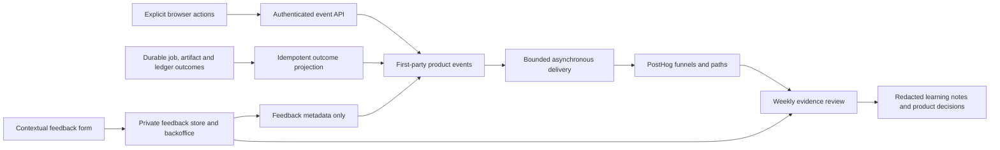

# Launch analytics, feedback, and learning plan

Implementation follow-up: the user authorized consolidation without a separate
synthetic-journey gate. See the [current operating guide](../reference/observability.md)
for implemented behavior and remaining activation steps. This research records the
decision basis, not evidence that cloud delivery is live.

**Status: Proposed.** Researched September 26, 2026 against checkout `c0ffdf7`
and current official vendor documentation. Repository observations below are
verified by inspection; production configuration and customer behavior were not
inspected. No analytics service, tracking code, feedback form, or automation was
activated as part of this research.

The companion [telemetry simplification plan](2026-09-26-observability-simplification.md)
extends this design to operational errors, logs, and tracing. Implement the
shared account/operation context and authoritative outcome hooks once for both
workstreams. That plan owns trace delivery and operational debugging; this one
owns product event delivery, feedback, and learning. Diagnostic logs/spans do
not need the durable analytics forwarding queue.

## Recommendation

Use **PostHog Cloud for journey analysis, Canary's existing records for verified
outcomes, and a small private feedback inbox in the existing backoffice**. The
[single-vendor follow-up](2026-09-26-posthog-single-vendor.md) also recommends
PostHog for errors and operational observations, subject to its integration
proof; Sentry remains the fallback. Start with explicit events and keep session replay off. Spend the
implementation effort on accurate milestones and actionable feedback rather
than building a general analytics platform.

The first question is: **Can a new author independently turn a scene into an
export they consider useful, and what gets in their way?** A generated image,
successful text check, export package, download request, and satisfied author
are different outcomes. Measure them separately.

Use a weekly review to produce one dated learning note and one improvement
decision. This fits the existing [self-service launch strategy](../proposals/self-service-launch.md),
which asks for seven-day outcomes and counts founder rescues explicitly.

## What already exists, and what is missing

| Current evidence | Implication |
| --- | --- |
| [Product events](../../novel_to_comic/src/novel_to_comic/server/product_events.py) persist selected server milestones in Supabase. [Browser ingestion](../../novel_to_comic/src/novel_to_comic/server/routers/events.py) authenticates the caller and checks project ownership. | Extend this boundary; a second product-event path is unnecessary for the initial authenticated flow. The single-vendor proposal adds a minimal browser SDK specifically for errors. |
| Property names and scalar size are bounded, but values are not event-specific enums. The [schema](../supabase-schema.sql) has no semantic deduplication key, schema version, release, or environment on events. Capture catches failures but performs a synchronous database write. | Add typed values, stable identities, explicit provenance, and failure monitoring. Exception suppression alone does not prevent analytics latency affecting a request. |
| [ProjectRooms](../../web/src/layout/ProjectRooms.tsx) emits `station_viewed`; [CreditsPage](../../web/src/pages/CreditsPage.tsx) emits `checkout_cancelled`. `inspect_drawer_opened` is allowed but has no capture callsite found. Old `panel_flagged`/`panel_regenerated` names have no emitters found. | Declared events are not evidence of coverage. Build a tested event inventory around current full-page workflows. |
| [Pipeline events](../../novel_to_comic/src/novel_to_comic/server/routers/pipeline.py) emit `stage_started` before credit reservation. Credit denial returns without a matching product failure event. Draw dispatch can emit success before page jobs finish. | Existing stage events cannot establish paid work starting or the first finished page. Observe admission, actual execution, and persisted artifacts separately. |
| [Export](../../novel_to_comic/src/novel_to_comic/server/routers/export.py) emits `export_succeeded` after building a package; its existing-package return bypasses capture. Downloads use a separate route. | Rename the measured outcome to package readiness and add download intent. Do not describe either as a completed download or approval of image quality. |
| `ops_product_funnel_daily` in the schema counts events/users/projects per day. [Backoffice](../../novel_to_comic/src/novel_to_comic/server/routers/backoffice.py) reads at most 5,000 recent events and counts export events. Its [UI](../../web/src/pages/BackofficePage.tsx) explicitly leaves historical funnel/activation empty. | Daily counts are not ordered cohort conversion. Do not build launch rates from the capped snapshot or count export requests as unique activated authors. |
| [Support links](../../web/src/lib/support.ts) prefill email with bounded diagnostics. Backoffice support has no durable connected store. | Reuse the safe context model, add durable feedback, retain email as fallback. |
| Sentry (historical Sentry integration) is configurable; replay defaults to zero, with masked text/media if enabled. [Signup](../../web/src/pages/auth/LoginPage.tsx) supports a validated public-book referral marker. | Keep error and product-event contracts distinct; provider consolidation is covered by the single-vendor proposal. Extend attribution carefully. Configuration in source does not establish production activation. |
| The [privacy page](../../web/src/pages/legal/PrivacyPage.tsx) describes operational usage and monitoring, not this proposed behavioral analytics/feedback system. Event user/project foreign keys use `ON DELETE SET NULL`. | Update disclosure with activation. Nulling references is not equivalent to deleting events or free text; deletion must cover each store explicitly. |

## Build versus buy

The [vendor evidence note](2026-09-26-analytics-vendor-research.md) contains the
full comparison and direct official sources. The decision is:

| Choice | Decision and reason |
| --- | --- |
| PostHog Cloud | Recommended. Buy funnel, path, cohort, and person-timeline exploration; maintain only the event contract. Published allowance is 1 million analytics events/month free. [Pricing](https://posthog.com/pricing) |
| Supabase alone | Valid fallback for a tiny invited cohort and weekly SQL review, especially if adding a processor is undesirable. Existing storage is valuable, but implementing exploration and historical dashboards costs developer time. |
| Plausible | Useful for website traffic. Its intentionally nonpersistent visitor identity does not support Canary's cross-day author journey. Do not add it alongside PostHog at launch. [Data policy](https://plausible.io/data-policy) |
| Canny or a public voting board | Defer. First learn the underlying problems; a public roadmap, moderation, duplicate voting, and another account system are unnecessary initial work. Free currently covers 25 tracked users. [Plans](https://help.canny.io/en/articles/9131812-canny-s-billing-plans) |
| Session replay / heatmaps | Defer. Private manuscripts, rendered text, art, and editor canvases make capture controls significant work. Curated events plus direct feedback are the starting evidence. |

Illustrative planning volume: 100 authors × 200 explicit interactions is 20,000
events, plus server outcomes. This is an assumption, not measured traffic.
Begin with a $0 PostHog usage budget, no paid add-ons, and watch delivery/drop
counts. PostHog drops additional events at a free/billing limit, so a budget cap
does not guarantee complete analytics. Existing Supabase costs still apply.
[Pricing and caps](https://posthog.com/pricing)

## Measurement contract

### Cohorts and outcomes

Use the account for author-level metrics and project/edition for production
metrics. A user completing steps in different projects must not accidentally
satisfy a same-project funnel. Exclude operator/test accounts and nonproduction
environments explicitly, without dropping genuine failed attempts.

For launch, select each author's **first production project with an admitted
Story analysis** as their first-scene project. Its admission time starts a
seven-day outcome window. Segment sample-library versus own-source work and
paid versus grant-funded participation; keep purchase as an account-level
branch because it can occur before or after project creation.

| Question | Definition |
| --- | --- |
| Do signups start? | Distinct verified accounts that create a project and admit Story analysis within seven days of verification / verified accounts with a complete observation window. Report verification-to-project and project-to-admission separately. |
| Do authors reach their first result? | First-scene projects with a persisted first page / admitted first-scene projects, within seven days. Separately count authors who actually viewed that page. |
| Can they finish independently? | Authors whose first-scene project reaches verified package readiness within seven days, without an operator rescue / eligible first-scene starters. Show assisted completions separately, plus all-start and paid-start cohorts. |
| Where do they pause? | Ordered transitions through Story admission → Brief approval → Style selection → Cast approval → first page ready → package ready. Show unresolved counts and elapsed time at each step. Branch into credit blocks, terminal failures, review checkpoints, and unknown inactivity. |
| Is the result useful? | Responses to “Would you use or share this result?”: yes / after changes / no / not sure. Show each count, response rate, and respondent cohort. Silence is unknown, not dissatisfaction. |
| Do they return for more? | A second distinct project with admitted generation within 30 days of first package readiness / authors with a full 30-day follow-up. Also show purchase again, separately. Login or opening an old project is not repeat production. |
| Is this manageable for one developer? | Authors requiring rescue / starters, operator minutes per starter, unresolved cases by age, and correction/failure incidence. Cost data comes from usage/ledger reconciliation, not analytics totals. |

Show `3/8 authors` beside percentages. Keep recent entrants marked **still in
window**. Report medians and ranges for early samples, and separate queue time,
execution time, and checkpoint wait; do not call wall-clock time active work.
No subsequent event means “no further activity observed,” not a known reason
for abandonment. Client events can be blocked or lost.

These metrics are proposed product definitions, not industry benchmarks.
Completion measurement should include partial/failed attempts and distinguish
genuine users from tests. [GOV.UK completion guidance](https://www.gov.uk/service-manual/measuring-success/measuring-completion-rate)

### Explicit event families

The list below is an implementation inventory, not existing coverage. Keep the
first release focused on the main funnel and feedback; add detailed editing
events when a concrete research question requires them.

| Events | Authority and safe properties |
| --- | --- |
| `account_verified`, `project_created` | Verified auth/account record and project creation. Source kind, attribution code, cohort ID; never filename/title/email. First authenticated observation is not a substitute for original verification time. |
| `station_viewed`, `estimate_viewed`, `first_page_viewed` | Browser observation: canonical station, action kind, estimate bucket, page ordinal. Emit for visible user actions, not polling or every render. |
| `generation_admitted`, `generation_started`, `generation_completed`, `generation_failed`, `generation_blocked` | Durable admission/execution/outcome evidence. Operation kind, stage, stable attempt/job identity, bounded reason, queue/execution duration. A cancelled job is a distinct outcome. Never equate queued with generated. |
| `brief_approved`, `style_selected`, `cast_approved` | Persisted decision, keyed to its revision. Keep current stage boundaries and selected-style gating. |
| `page_render_ready`, `page_correction_submitted`, `page_correction_completed` | Saved render identity and corresponding operation; distinguish initial art from correction, and art readiness from OCR or settlement failure. Page number and edition profile are sufficient; no imagery/instructions. |
| `lettering_saved` | Successful independent lettering revision, not each keystroke. Optional follow-up slice; never implies new Draw or visual approval. |
| `export_package_ready`, `export_download_requested` | Verified package revision/format and download action respectively. Emit readiness once per package identity, including packages produced outside the explicit export POST. A browser cannot prove the user saved/opened the file. |
| `checkout_started`, `credits_purchased` | Server Checkout receipt and verified settled ledger grant. Deduplicate purchase by grant/payment identity; no purchase event from the return-page redirect. |
| `feedback_submitted`, `outcome_response_submitted`, `operator_intervention_recorded` | Persisted private record. Category, station, rating enum, feedback ID or intervention duration/reason only. No message body in PostHog. |

All events need `event_id`, `schema_version`, occurrence and receipt timestamps,
environment/release, origin (`web`, `server`, or reconciled), and a stable opaque
account analytics ID. Project/edition, operation, and page IDs are optional and
must be verified when supplied. Use a browser session ID only for interaction
analysis; jobs finishing after logout still belong to the originating account,
not whoever happens to be signed in later.

Attribution should begin with bounded campaign codes, the existing validated
book-referral code, and explicit `direct`/`unknown`. Preserve first-touch source
at signup and do not overwrite it with later visits. Keep acquisition source
separate from project input source. Strip arbitrary query strings and referrer
URLs. Attribution is advisory and never authorization or billing evidence.

The initial authenticated pipeline cannot measure visitors who never register.
If landing-to-signup conversion is needed for the first campaign, add a separate
optional public event surface: landing viewed, sample opened, signup started,
signup submitted. Use canonical routes, bounded campaign IDs, rate limits, and
the chosen consent policy. Merge an anonymous ID only when permitted; retain
unknown attribution across lost storage, cross-device flows, or declined
tracking. Do not infer a visitor-to-account funnel from authenticated data alone.

## Architecture and reliability



Prefer the existing `trackProductEvent` → `/api/events` path and a server-side
PostHog sender. This avoids installing a second browser SDK merely to forward
these events. PostHog's browser SDK is optional if later requirements justify
it; its automatic capture features must remain disabled and its actual wire
payload tested. Choose one sending owner per event.

Use separate typed DTOs for each event, with enum/range checks on values, not
just allowed keys. The server derives account/environment identity. Preserve
ownership checks, account-change request cancellation, and backend-only secrets.
No raw URL, query string, exception message, manuscript, prompt, artwork, entity
name, auth header, or feedback prose belongs in event properties.

Business outcomes need a unique semantic key: for example, operation + terminal
transition, package revision + format, or settled credit grant. Browser events
get an event UUID reused on delivery retry. Distinct legitimate attempts get
distinct identities. Map the first-party event ID to PostHog's supported
deduplication field and verify behavior with the selected ingestion API before
depending on it. Do not claim exactly-once network delivery.

Record/projection and forwarding must be separate from paid execution. A small
bounded batch sender reads undelivered events, retries telemetry with backoff,
and records delivery status. An analytics outage must not fail a generation,
approval, export, or payment. Never retry the customer operation to recover a
missing event. Reconcile important outcomes from durable jobs, artifact records,
and ledger entries, using original timestamps where evidenced. Current state
alone cannot reconstruct every historical transition; label backfills and
unknown intervals rather than inventing a journey.

Build delivery count/age/failure visibility, a kill switch, and an explicit
data-freshness indicator before trusting the dashboard. A read failure must be
“unavailable,” not zero users. Avoid calculating rates from the backoffice's
5,000-row slice. PostHog holds exploration; a small server cohort export holds
the reconciled launch scorecard. Keep financial authority in the ledger.

## Private feedback that users will actually find

Put **Give feedback** in the persistent authenticated shell, with entry points
near error recovery and Book. A small accessible dialog asks:

1. **What would you like to share?** Something is frustrating / feature idea /
   something I like.
2. **What happened, or what were you trying to do?** Free text, maximum 2,000
   characters. For ideas, encourage the desired outcome rather than a specification.
3. Optional unchecked **You may contact me about this feedback**.

Show attached context before sending: station, project reference, optional page,
release, and safe error/job reference. Let the user omit optional project/page
context. Include “Please don't include manuscript text, passwords, or payment
details.” No automatic screenshot or recording attachment.

Submission is a real durable mutation: acknowledge only after persistence,
deduplicate retries, preserve the draft on failure, and keep an email fallback.
Clear drafts on account changes. Enforce ownership, length and rate limits,
plain-text rendering, and operator-only triage access. Treat feedback as
untrusted content if later summarized by an assistant.

Proposed record: feedback ID, authenticated owner, category, message, optional
context, follow-up permission/time, created time, status, theme, resolution,
and optional issue link. Statuses: new → reviewing → planned/resolved/closed.
“Planned” is an internal triage state, not a public delivery promise. Keep
intervention records separate so multiple comments do not inflate rescue counts.

Use the existing backoffice Support area for a list/detail view, theme/status
filter, issue link, and minutes spent. Avoid building chat, attachments, voting,
or email delivery infrastructure initially. Reply through existing support email
when appropriate; the form must not promise replies automatically.

After the author has viewed their first generated page, offer an unobtrusive
optional usefulness question. Offer the same short outcome question after
export, with optional “What should we keep or improve?” text. Cap unsolicited
prompts to one per account per seven days, remember dismissal, and never block
work. Users can always open feedback themselves. Sample both successful and
stalled authors; export-only feedback would miss those who never finish.
Feedback at several journey points helps connect dissatisfaction to context.
[GOV.UK satisfaction guidance](https://www.gov.uk/service-manual/measuring-success/measuring-user-satisfaction)

## Turn observations into documented learning

Budget **30–45 minutes weekly**, plus real incidents. This is a proposed working
budget, not measured support capacity. Review one cohort report, all new
feedback from the small initial cohort, and the largest unresolved transition.
Pick one change or one question requiring follow-up; do not fill a roadmap from
vote counts. Severe billing, privacy, or data-loss reports follow the existing
[support triage](../ops/support-triage.md) immediately.

For the first cohort, offer a few optional 15–20 minute follow-ups across
successful and stalled authors who agreed to contact. Ask what they expected,
what actually happened, what they tried next, and whether the result would be
useful. Do not require onboarding calls; count assistance if it occurs. No
outreach or scheduled automation is enabled by this proposal.

Automate a deterministic weekly draft of counts, denominators, incomplete
windows, top blocked transitions, feedback themes/counts, and intervention time.
Human review supplies interpretations and priorities. AI summaries, if added
later, must cite private evidence IDs and label hypotheses; do not automatically
send raw feedback to another model or create public issues.

Save reviewed, redacted notes in `docs/research/learning/YYYY-MM-DD.md` when
real evidence exists. Keep raw feedback, personal identifiers, and customer
quotes in the private store; repo notes contain aggregate observations and
nonidentifying evidence references. Do not fabricate a first learning report
before users arrive. Use this template:

```markdown
# Learning review — YYYY-MM-DD
Status: Observed findings; hypotheses and decisions labelled separately.
Cohort / release / observation window / data freshness:
Question:
Evidence: numerator/denominator, source links or private evidence IDs.
Observed behavior:
What users reported: redacted summary, response count and response rate.
Interpretation and competing explanations:
Confidence / missing evidence:
Decision: change, investigate, or leave unchanged; reason.
Owner / issue (if created):
Expected observable improvement:
Next review date / eligible follow-up cohort:
Result at follow-up:
```

Separating observation, interpretation, and action follows the research analysis
method in the [GOV.UK research guide](https://www.gov.uk/service-manual/user-research/analyse-a-research-session).
Small cohorts reveal problems and hypotheses; they do not establish causality
or statistically reliable percentage changes. Track the next cohort and
feedback together rather than starting A/B testing at launch.

## Privacy and lifecycle decisions

Default to no session replay, automatic DOM collection, or network-body capture.
Use an opaque random analytics ID mapped privately to the account, not an email
hash. If the server sends events, do not forward client IPs; avoid misleading
server-location/device enrichment. Only collect coarse device information if
there is a specific analysis need. Vendor storage/identity controls are detailed
in the [vendor note](2026-09-26-analytics-vendor-research.md).

Before production activation, choose the cloud region and the analytics
consent/opt-out behavior appropriate to the actual launch audience; jurisdiction
and legal basis were not established by this research. Do not assume first-party
transport makes analytics exempt. A conservative implementation can leave
optional behavioral collection off until the user's choice is recorded while
retaining operational records needed to provide the service.

Proposed retention: twelve months for pseudonymous product events (matching the
published free PostHog event-retention window), feedback until 180 days after
closure, and redacted aggregate learning notes thereafter. These are product
defaults to decide and implement, not existing policy or legal requirements.
Account deletion should remove feedback and identifiable analytics in both
stores, including queued exports, with a deletion tombstone preventing later
reconciliation from recreating them. Financial/legal records have a separate
lifecycle. Feedback deletion must not leave copied prose in issue bodies or
reports. Verify vendor deletion completion rather than equating a submitted
request with erased events.

## Implementation slices and acceptance evidence

Planning estimate: **roughly 5–8 focused developer days** for the authenticated
core below, with uncertainty around identity, reconciliation, and deletion.
This is an engineering estimate, not a delivery commitment. Anonymous marketing
measurement and automated weekly report generation can follow the first cohort.

| Slice | Deliverable | Acceptance evidence |
| --- | --- | --- |
| 1. Contracts and trustworthy outcomes (1–2 days) | Typed event catalog, semantic keys, release/environment/cohort fields, admitted/terminal/render/package milestones, source-of-truth mapping. | Provider-free fixture journeys count a paid success, credit denial, failed attempt, cached export and deliberate retry correctly. Duplicate deliveries never inflate unique outcomes. Draw dispatch never means page ready. |
| 2. PostHog delivery and initial reports (1–2 days) | Async sanitized sender, budget/kill switch, account identity, production filters, main funnel, time-to-first-page and incomplete-cohort views. | Captured outbound payloads contain only allowed values. Account A → logout → B stays separated. Outage/cap causes visible telemetry lag, not failed customer work. Reconciled counts agree with fixture authorities. |
| 3. Feedback and triage (2–3 days) | Persistent dialog, private store/API, safe context, email fallback, minimal backoffice inbox, outcome question and operator minutes. | Ownership/RLS and rate limits hold; retry dedup works; draft survives submission failure but not account switch; no free text reaches analytics; keyboard/mobile flow works; permission is stored. |
| 4. Pilot validation and learning routine (about 1 day) | One synthetic report, deletion/opt-out check, seed-sensitive-data check, instrumented release checklist, learning-note template in use. | Seven-day denominators and unknowns are explicit; stale data is labelled; deletion reaches both stores and prevents re-export; first real cohort can produce a reviewable note. |

Use focused backend observability/API tests and frontend event/form tests; run
frontend build/lint when that code changes. Test with synthetic content and
mocked providers, then verify delivery using synthetic events in the chosen
analytics environment. No paid generation is needed to test tracking.

Implementation should first confirm PostHog ingestion/deduplication API details,
actual production analytics/Sentry settings, migration state, and launch-region
requirements. Those remain open deployment facts, not reasons to discard this
design. The next step is implementing the agreed slices, not activating a vendor
or collecting real user data during this research pass.
