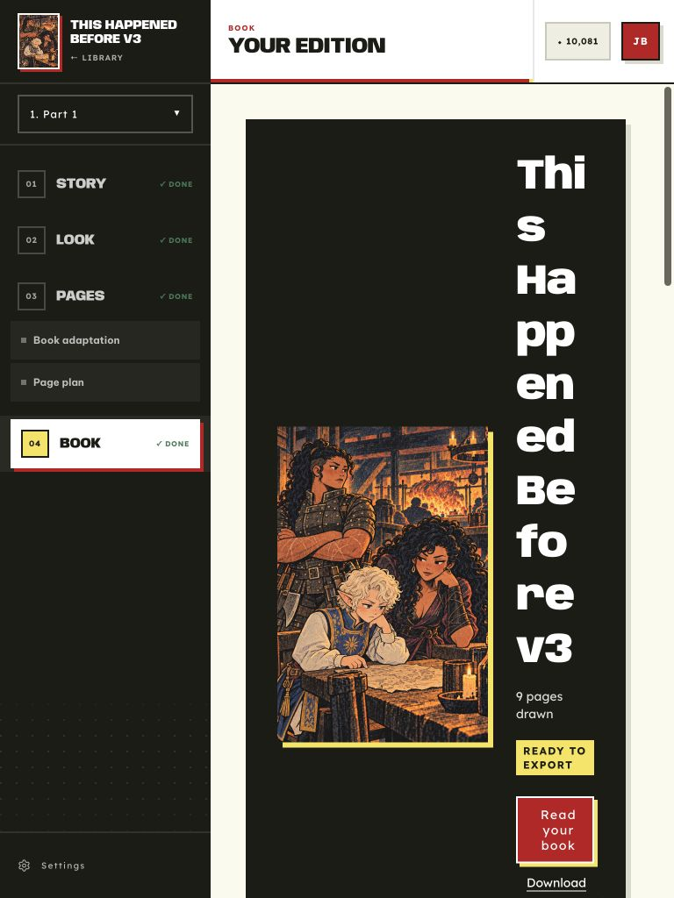

# Responsive layout review — October 5, 2026

**Status: Historical.** Review of checkout `2941dcbf` and the user-managed local
server. Recommendations below are proposed changes, not implemented behavior.

The reported split-screen problem is reproducible. The largest weakness is the
768–1024 px range: the application switches to a large desktop shell while room
components independently enable multiple columns using the browser width. They
do not account for the space already consumed by navigation and gutters. Several
phone layouts are consequently more readable than wider, tall windows.

This review contains nine reproduced findings and a separate list of source
risks that still require visual verification. No application source was changed.

## Method and evidence

Reviewed the route inventory in `web/src/App.tsx`, shared shell, room layouts,
dialogs, public pages, authentication, onboarding, settings, credits, lettering,
and operator/development surfaces. Used real project content in Chrome against
the running local server. The primary complete project was **This Happened Before
v3**, with nine rendered pages and integrated lettering. Older projects provided
loading/error-state evidence, but did not supply a working editable-lettering
editor under the current artifact contracts.

Key measured CSS viewports were 320×640, 375×812, 767×1024, 768×1024,
801×1024, 1024×768, 1024×600, and 1280×800. These were selected checks,
not an exhaustive cross-product of every route, state, and size. Public-origin
browser zoom required compensating the viewport override; measurements use
actual `innerWidth`/`innerHeight`, not requested screenshot dimensions.

[Raw DOM measurements](measurements.json) record container widths, grid tracks,
and horizontal overflow. Screenshots are adjacent to this report. A clean root
`scrollWidth` is insufficient evidence of a good layout: nested scroll areas,
clipping, tiny columns, and wrapped words can still make content unreadable.

No project creation, generation, publication, account update, payment, or
destructive confirmation was submitted. The new-production wizard was inspected
through all three local steps and cancelled. This is a layout review, not a full
accessibility conformance assessment or a production/device compatibility test.

## Priorities

P1 means the layout materially impairs a primary reading or working task.
P2 means degraded readability, wasted working space, or a problem on a secondary
surface. Grouped findings below describe distinct fixes; several share a cause.

| ID | Priority | Finding | Evidence |
| --- | --- | --- | --- |
| R1 | P1 | Desktop shell removes 295 px of content at the 768 px breakpoint | 767/768 Story comparison |
| R2 | P1 | Book cover leaves only 89 px for its title and reading controls | Book at 768 px |
| R3 | P1 | Two navigation columns leave settings fields only 153 px | Project settings at 768 px |
| R4 | P1 | Reader defaults to tiny two-page spreads on narrow windows | Pages 2–3 at 375 px |
| R5 | P2 | Gallery column counts shrink cards at intermediate widths | Look, Cast, Pages |
| R6 | P2 | Masthead hides task titles, sometimes more at wider widths | Story, Look, Cast, Pages |
| R7 | P2 | Reader inherits 40 px bottom margin and fails to cover the viewport | Reader at 320 and 375 px |
| R8 | P2 | Labs expands to approximately 1,400 px inside a phone viewport | Labs at 375 px |
| R9 | P2 | Cast metadata containing scene IDs spills past its text column | Prop cards at 768/1024 px |

## R1 — The desktop shell starts before there is room for it

**Reproduced:** Story at 767×1024 and 768×1024.

| CSS viewport | Sidebar | Horizontal sheet padding | Content width | Main scroll-area height |
| --- | ---: | ---: | ---: | ---: |
| 767×1024 | hidden | 24 px | 728 px | 968 px |
| 768×1024 | 240 px | 80 px | 433 px | 790 px |

An extra pixel of browser width removes **295 px, or 40.5%, of the content
width**. At 768 px, actual content receives only 56% of the window. Desktop
masthead and standing action footer also reduce the visible working height.
This is a direct match for a tall window beside a video call.

The custom desktop media query is `(width >= 768px and height >= 512px) or
width >= 1024px`. It enables a 240 px sidebar and 40 px gutters on both sides;
the sidebar grows again to 270 px at 1280 and 320 px at 1536. A tall aspect ratio
qualifies for this layout without increasing available horizontal space.

**Sources:** `web/src/index.css:3`, `web/src/hooks/useDesktopLayout.ts:3`,
`web/src/layout/Shell.tsx:28`, `web/src/layout/SideNav.tsx:284`,
`web/src/layout/TopBarSlot.tsx`.

**Recommended change:** Keep the compact station navigation until a useful
workbench width can coexist with the sidebar. Offer an explicit sidebar collapse
or narrow rail for split-screen use. Use fluid 12–24 px gutters in constrained
windows; reserve 40 px for sufficiently spacious containers. Match the CSS and
JavaScript layout predicates so masthead/footer placement agrees with the shell.
Also account for height before pinning large action bars. At 1024×600, Story's
main scroll area is 428 px high before its 80 px vertical sheet padding.

**Acceptance:** Moving from 767 to 768 must not reduce usable content width.
At 768×1024, primary reading content should retain at least roughly 650 px
with compact navigation. Any final threshold should follow the content's minimum
usable width, rather than a device category.

[Story at 767 px](story-767.jpg) · [Story at 768 px](story-768.jpg) ·
[Short desktop window](story-1024x600.jpg)

## R2 — Book's fixed cover column breaks the title and actions

**Reproduced:** Book at 768×1024, using a normal 22-character project title.

The 433 px hero uses 72 px horizontal padding, a 32 px gap, and a 240 px
cover column. The remaining text track is **89 px**. “This Happened Before v3”
breaks into fragments such as “Thi / s / Ha / pp / en / ed”. The reading button
also wraps into a narrow tower. Most of the first viewport is consumed by an
oversized dark hero with little useful text visible.

**Source:** `web/src/pages/rooms/BookRoom.tsx:175` enables the side-by-side hero
with `md:grid-cols-[minmax(0,15rem)_minmax(0,1fr)] md:p-9`.

**Recommended change:** Stack cover and text based on the hero's own width.
Require room for both the cover and a useful text column before switching to
two columns. Reduce hero padding in constrained containers. Apply the same
available-width check to the export cards and publication form below it.

**Acceptance:** At 768×1024 with either navigation mode, normal titles wrap at
word boundaries, the primary read action remains readily scannable, and cover
size does not dictate an excessive hero height.

## R3 — Project settings has two sidebars in a 433 px workbench

**Reproduced:** General and Language tabs at 768×1024.

After the studio sidebar and gutters, SettingsLayout takes another 200 px for
section navigation and 36 px for its gap. Its form column becomes 197 px;
borders and row padding reduce the actual field/text track to **153 px**.
Hints become tall columns, the project-name input exposes little of its value,
and language controls have disproportionate whitespace around them.

Account settings uses the same component but has no studio sidebar. At the same
width it has a 452 px content column, illustrating why a viewport `md` rule
cannot serve both contexts well.

**Sources:** `web/src/components/ui/SettingsLayout.tsx:17` and `:34`,
`web/src/pages/ProjectSettingsPage.tsx`, `web/src/pages/AccountPage.tsx`.

**Recommended change:** Keep section navigation horizontal or use a section
selector until the settings container can support a 200 px rail plus an
adequate form. Base SettingsRow's label/control split on the row container too.

**Acceptance:** At 768×1024, Project settings has a single readable form column;
navigation does not leave controls with a 153 px track. Validate all tabs,
including long project names and translated labels.

[Project settings screenshot](project-settings-768.jpg)

## R4 — Narrow readers default to unreadably small spreads

**Reproduced:** Open Book's reader at 375×812, then advance from page 1 to
pages 2–3. Each page is approximately **175.5×261.7 px**, surrounded by large
unused areas above and below. Comic dialogue becomes difficult to read.

The cover/single page initially appears much larger, so the loss of readability
happens on the first page turn. The reader offers single-page, fit-width, and
zoom controls, but the default presentation asks readers to discover them.

**Sources:** `web/src/components/BookReader.tsx:164` initializes `spreads` and
`:165` initializes fit to `height`; `ViewLayer` at `:119` and `:129` keeps facing
pages side by side. `web/src/pages/PublicBookPage.tsx` uses this same reader.

**Recommended change:** Default to one page and a width-oriented presentation
when the reader cannot provide useful page widths. Enable spreads only when two
pages can remain readable. Preserve explicit reader choices while resizing.
Keep zoom available for small lettering even in single-page mode.

**Acceptance:** At 320/375/768 px, a normal page turn does not halve page width.
Test both owner and public reader entry points and opening a specific page.

[Single page at 375 px](reader-375.jpg) ·
[Default spread at 375 px](reader-spread-375.jpg)

## R5 — Galleries add columns using the wrong available width

**Reproduced:** Look and Cast at 768/1024 px; Pages at 768/1280 px.

| Gallery | Viewport width | Columns | Approximate card width |
| --- | ---: | ---: | ---: |
| Look | 768 px | 2 | 204.5 px |
| Look | 1024 px | 3 | 213.7 px |
| Cast characters | 768 px | 2 | 206.5 px |
| Cast characters | 1024 px | 3 | 216.3 px |
| Pages | 768 px | 2 | 206.5 px |
| Pages | 1280 px | 4 | 213.8 px |

Borders and 40 px of internal padding leave some Look text only about 160 px
wide. Titles become fragmented, descriptions wrap heavily, and artwork is
small relative to the window. Pages' four-column layout at 1280 px offers
surprisingly little more card width than its two-column layout at 768 px.
Thumbnails need not display every line of comic dialogue, and full-page review
and zoom already exist; the issue is gallery density and readability of card
labels/actions as well as comparing artwork.

**Sources:** `web/src/pages/rooms/StyleRoom.tsx:698`,
`web/src/pages/rooms/CastRoom.tsx:1466`, `:1485`, `:1501`,
`web/src/pages/rooms/PagesRoom.tsx:882`.

**Recommended change:** Use container queries or auto-fit columns with a
measured minimum card width, initially exploring 260–320 px depending on card
content. Library's `repeat(auto-fill,minmax(min(100%,270px),1fr))` at
`web/src/pages/Library.tsx` already supplies a useful local pattern. Consider a
user-controlled density choice for Pages instead of automatically favoring more
columns.

**Acceptance:** Cards never become narrower solely because a viewport breakpoint
adds a column. Check 639/640, 767/768, 1023/1024, and 1279/1280 px with sidebar
expanded and collapsed. Validate long names and action labels inside each card.

[Look at 768 px](look-768.jpg) · [Look at 1024 px](look-1024.jpg) ·
[Cast at 768 px](cast-768.jpg) · [Pages at 1280 px](pages-1280.jpg)

## R6 — The masthead clips the primary task title

**Reproduced:** Story, Look, Cast, and Pages mastheads.

Story's title needs 365 px but gets 327 px at 768 and only about 217 px at
1024. The larger viewport adds a station block and explanatory lead, while
restricting the title to 42% of its container. Cast's title needs 423 px and
gets 216 px at 1024. Look's “ADD A DIRECTION” action leaves its title only
134 px at 768. Pages is still clipped at 1280 (311 px available, 326 px needed).

This hides the instruction telling the user what to do. A `title` tooltip does
not make the visible instruction readily readable, particularly on touch.

**Source:** `web/src/components/composites/RoomHeader.tsx:38`, `:47`, `:51`,
`:59`, and `:67` combine the fixed station block, percentage cap, truncation,
lead, and nonshrinking actions.

**Recommended change:** Give the task title priority over redundant station
chrome and explanatory lead. Allow a controlled two-line title. Move secondary
actions to a compact menu or the content flow when there is insufficient room.
Choose these transitions by header space, not just viewport `lg`.

**Acceptance:** All normal English room titles are visible at 768 and 1024 px;
French/Spanish titles and expanded controls also remain usable. Increasing the
window width must not reveal less of the task title.

[Story at 768 px](story-768.jpg) · [Look at 768 px](look-768.jpg) ·
[Cast at 1024 px](cast-1024.jpg)

## R7 — The full-screen reader inherits page spacing

**Reproduced:** Owner reader at 320×640 and 375×812.

The fixed reader is a direct child of RoomShell's `space-y-10`. Because another
section follows it, it inherits a **40 px bottom margin**. At 320×640 its dialog
is only 600 px high; underlying Book content shows through below it. The same
40 px gap is visible in the 375 px spread screenshot. ImageViewer, which mounts
at the viewport layer, covers the complete 640 px height.

**Sources:** `web/src/components/composites/RoomShell.tsx:71`,
`web/src/pages/rooms/BookRoom.tsx:199`, and
`web/src/components/BookReader.tsx:271`.

**Recommended change:** Mount the reader at the viewport layer using the shared
dialog conventions, or explicitly neutralize parent spacing on the overlay.
Prefer one consistent overlay placement approach for reader and image viewer.

**Acceptance:** The dialog rect equals the viewport bounds, with zero inherited
margins, at 320×640, 375×812, and desktop sizes. Underlying room content is fully
covered. Check focus, close, nested zoom, and restoration to the opener.

[Reader with bottom gap](reader-gap-320.jpg) ·
[ImageViewer covering the viewport](image-viewer-320.jpg)

## R8 — Labs expands beyond the workbench

**Reproduced:** `/labs` at 375×812 with existing run history.

The outer Labs container becomes 1,400 px wide; its grid track is about
1,442 px, and the shared main scroller has `scrollWidth` 1,470 px against
`clientWidth` 360 px. Root document width still reports 375 px. Most content
and controls sit outside the visible workbench.

**Sources:** `web/src/pages/LabsRoom.tsx:862` uses a max-width container as a
flex child without an explicit width/min-width constraint. The unbounded
single-column grid at `:868` contains long run labels. Arm selectors at `:204`
and `:215` also impose 16 rem and 12 rem minimum widths.

**Recommended change:** Constrain the root flex child with `w-full min-w-0`,
make the single-column grid `minmax(0,1fr)`, and let selectors fit their actual
containers. Keep deliberate horizontal scrolling scoped to comparison tables.
Recheck populated histories, model names, and result views after the root fix.

**Acceptance:** At 320/375/768 px, the workbench itself does not overflow
horizontally. Form controls remain reachable; only explicitly labeled tables
or image canvases may require horizontal panning.

[Labs at 375 px](labs-375.jpg)

## R9 — Cast metadata does not wrap long scene identifiers

**Reproduced:** Prop cards at 768 and 1024 px.

“First seen: scene_the_headless_snug” has a 185 px scroll width inside a 163 px
paragraph at 768; `scene_sphinx_examination` needs 188 px. The metadata crosses
its text track, unlike the descriptions that already use wrapping classes.

**Sources:** `web/src/pages/rooms/CastRoom.tsx:493` renders metadata without a
wrapping rule; `:1060` supplies first-appearance scene text.

**Recommended change:** Prefer the human-readable scene name when available,
and apply overflow wrapping to identifiers/fallbacks. Do not silently clip
metadata needed to identify the first appearance.

**Acceptance:** Scene IDs and long translated metadata remain inside the card
at its minimum supported width. Widening galleries should improve this, but is
not a substitute for handling unbroken content.

## Source risks requiring visual confirmation

These are not included in the nine reproduced findings.

| Surface | Source evidence | Next verification |
| --- | --- | --- |
| Lettering style preview | `lettering.css:40` switches above 800 px to a 300–390 px control track plus 28 px gap. A studio workbench at 801 px is only about 466 px wide after sidebar/gutters; controls can take most of it. | Load a current hybrid project at 800/801 and 1023/1024 px; measure preview and fields in the Look room. Switch by container width. |
| Page lettering editor height | `lettering.css:49` gives the modal body percentage heights, clips overflow, and lets the workspace flex into remaining height above 800 px. `PagesRoom.tsx:215` gives the dialog explicit full height only at `lg`/1024 px. | Check canvas and inspector visibility at 801–1023 px with populated lettering and placement checks. Align the height model and breakpoint. |
| Backoffice navigation | `BackofficePage.tsx:833` fixes sidebar height to the viewport; `:836` has shrinking nav space but no vertical scrolling. Header/environment/footer chrome competes with all sections in short windows. | Authenticate with a user-provided operator session and test all sections in 1024×600 and phone landscape. Give nav its own scroll region if needed. |
| Backoffice typography | Multiple metadata/table styles use 0.48–0.58 rem, approximately 7.7–9.3 px. | Visually check populated operator tables and errors, browser zoom, and text scaling. Increase meaningful metadata rather than only reducing padding. |
| Insufficient-credit dialog | `InsufficientCreditsDialog.tsx:148` keeps three balance columns at phone width, with padding and gaps. | Render provider-free fixtures with large balances/estimates and translated labels at 320 px. Check word/number overflow and short heights. |

## Coverage and limits

“Source” means layout/code inspected, without claiming a successful live render
of that particular state. “Live” means the listed reachable state was checked;
it does not certify every interaction, translation, or data variant.

| Page or surface | Coverage | Result / limitation |
| --- | --- | --- |
| Shared shell, station sidebar, mobile station picker, masthead, action footer | Live + source | R1 and R6; main shell failure is intermediate widths. |
| Signed-in Library | Live 375 + source | Auto-fill card grid handles narrow content better than room galleries. |
| New production | Live all 3 steps at 375 + source | Sample choice, details, lettering choice stack; bounded body scroll and accessible footer. Manuscript upload/paste variants source-reviewed. |
| Story | Live 375, 767, 768, 1024 + source | Brief and scenes reflow; shell and masthead failures remain. Entity editing checked with long real descriptions. |
| Story Bible entity sheet | Live 375 + source | Fields stack; long body scrolls; changes were not saved. |
| Parts/add/split/replace | Source; part menu inspected live | Shared Sheet, wrapping rows, and bounded inputs. Part management sheet itself was not visually verified. |
| Look/art style | Live 768/1024 + source | R5/R6. Proof detail dialog checked at 768 and stacks effectively. |
| Cast characters/places/props | Live 375/768/1024 + source | R5/R6/R9. Detail dialog checked at 375 and is substantially more readable than the narrow gallery. |
| Pages gallery/review | Live 375/768/1280 + source | R5/R6; page review dialog checked at 375. Art/lettering editor source risk remains. |
| Book, preflight, download/publication panels | Live 320/768 + source | R2. No exports or publishing submitted. |
| Owner BookReader | Live 320/375 + source | R4/R7. Existing fit and zoom options provide manual remedies for small pages. |
| ImageViewer | Live 320 + source | Zoom toolbar fits (about 294 px); full-screen viewer covers the viewport. |
| Project settings | Live General/Language at 768 + source all tabs | R3. No configuration changes saved. |
| Account | Live 768 + source email/password/model forms | No comparable width squeeze without the studio sidebar; no account updates submitted. |
| Credits and history | Live 375 + source | Pack cards stack and history reflows. Payment checkout not invoked. |
| Public homepage | Live 375 + source | Main copy stacks. Decorative manuscript/art crop is intentional and was not counted as inaccessible content. Section navigation disappears below 1180 px without a compact replacement; consider improving discoverability. |
| Public sample shelf and text reader | Live 375 + source | Single-column cards; comfortable text wrapping; no measured horizontal text overflow. |
| Public book `/read/:id` | Source; shared reader live through owner entry | R4 applies to shared reader defaults. Published introduction, download actions, language variants, and end card not live-verified. |
| Login / signup | Live 375 + source | Shared form stacks; account-creation inputs checked. No credentials submitted. |
| Password reset / auth callback | Live unauthenticated reset redirect and callback error at 375 + source | Actual password-recovery form requires a recovery session and was not live-verified. |
| Terms / Privacy / Acceptable Use | Live 375 + source | Shared navigation wraps; body text does not horizontally overflow. |
| Not found | Live 375 + source | Title/body wrap and return action fits. |
| Shared Sheet / confirmation drawer / confirmation modal | Sheet and confirmation drawer live 375; modal source | Bounded vertical scrolling and wrapping actions are useful patterns to reuse. No destructive confirmation submitted. |
| Loading / locked / error states | Live encountered project loading/error states + source placeholders | Legacy editable project reached a style-load error, preventing editor verification. Source inspection is not proof of paid/in-flight states. |
| Backoffice | Live connection gate 375 + source operator sections | No operator token/session supplied; populated analytics, users, failures, payment actions, and tester iframe source-only. |
| Labs | Live populated setup/history 375 + source comparisons | R8. No experiment submitted. |
| Development primitive board | Live 375, including confirmation drawer + source | Minor nested overflow on the reference board; production primitives need verification in their actual containers. |

No live paid generation states, browser soft keyboard, physical touch devices,
200% text scaling, long translated data sets, or cross-browser matrix were
tested. Remaining coverage gaps should be closed with provider-free fixtures
before treating the responsive work as complete.

## Recommended implementation order

1. **Shared shell:** compact/collapsible navigation, available-width gutters,
   coordinated masthead/footer transitions. This restores space across rooms.
2. **Container-aware page layouts:** Book hero, project settings, room galleries,
   and title/action allocation. These must still work with navigation expanded.
3. **Reader:** narrow-window defaults and viewport-layer placement.
4. **Robust content:** Cast identifier wrapping and Labs root/grid constraints.
5. **Close the source-only gaps:** hybrid lettering, populated backoffice,
   credit gate, recovery form, published reader, and multi-part workflows.

Keep the existing visual character. The first response should reclaim space and
reduce unnecessary columns, not make body type smaller. Typography should remain
readable when the app shares a laptop screen with a call.

## Verification for the eventual fixes

Use repeatable browser measurements/screenshots with seeded, provider-free data.
Existing component tests can validate behavior but do not measure browser layout.
`mobileShellLayout.test.tsx`, `styleRoomComparison.test.tsx`, and reader tests are
useful touchpoints; class-name assertions alone will not catch these failures.

- Cover breakpoint pairs 639/640, 767/768, 800/801, 1023/1024, and 1279/1280.
- Include 320×640 and 375×812 phones; tall 720×1000, 768×1024, and 900×1200
  split windows; short 1024×600 and 900×500; a wide desktop reference.
- Measure workbench and nested scrollers, minimum card/control widths, title
  overflow, and overlay bounds. Scope expected horizontal panning to labeled
  tables and image canvases.
- Use long book/style/entity names, scene IDs, large credit values, many parts,
  French/Spanish labels, browser text scaling, and a visible soft keyboard.
- Exercise expanded/collapsed navigation, reader page turns, nested zoom,
  dialog scrolling/close, and viewport changes while a dialog is open.
- After implementation, run affected frontend checks, build, and lint under the
  repository's workflow; visually recheck the real browser before declaring the
  layout issues fixed.

For this review-only change, application tests/build/lint were not required.
`python3 scripts/check_docs_reliability.py` passed. Only this report and its
evidence files were added to the shared checkout.
