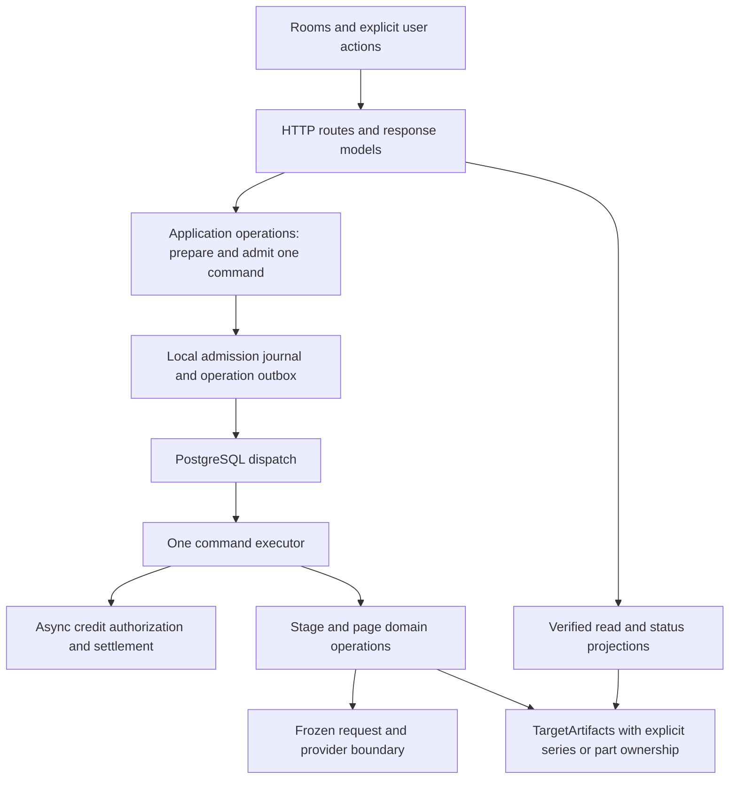

# Canary architecture review — October 6, 2026

**Status: Historical review snapshot and proposed work, not an implementation contract.**

The fixes and verification are recorded in the [implementation report](2026-10-06-architecture-implementation.md).
Code references and reproduction assertions below describe commit
`7885e84a13568467911776601a2a91c5abe9f5fd` before those fixes.

Reviewed commit: `7885e84a13568467911776601a2a91c5abe9f5fd`. The checkout was clean when the review started. This review adds documentation and a provider-free reproduction script; it does not fix the application or change deployment configuration.

## Assessment

Canary has a defensible core architecture. Its stages, typed artifacts, frozen image requests, paid-submission recovery rules, and independent lettering are useful domain boundaries. A modular application with one artifact-volume owner fits the current product. The problem is that later features do not consistently use those boundaries: execution has two representations, series and part ownership differ across locks and APIs, and an export file can be treated as authoritative without its manifest.

The best next investment is to reduce the number of places that must agree about an action. Keep the eight stages. Consolidate execution, ownership, and verified reads; remove the older execution path after its tests use the production path. Splitting large files alone would preserve the coordination problem.

The review distinguishes reproduced defects, code-supported risks, deployment-dependent risks, and an explicitly accepted product limitation. It does **not** establish current production database grants, enabled R2 configuration, or image quality. Some concerns, particularly export freshness, route policy, and retention, were already identified in the [September 19 review](2026-09-19-security-billing-architecture.md). They remain present in the reviewed code.

## Ranked findings

P1 means address promptly because it affects an authentication boundary or can interrupt shared service operation. P2 means a concrete functional, maintenance, or capacity gap that should follow in bounded changes. Priority does not imply an incident occurred.

| ID | Priority | Finding | Evidence |
| --- | --- | --- | --- |
| F01 | P1 | Logout leaves the backend read cookie authenticated | Reproduced; frontend/backend lifecycle mismatch |
| F02 | P1 | The advertised canonical SQL omits the project write-security migration | Code and runbook; impact depends on existing grants |
| F03 | P1 | Series-wide lettering writes use part locks and can deadlock | Deterministic concurrent-write reproduction |
| F04 | P1 | Synchronous ledger calls block the API/queue event loop | Fault-injected slow ledger call reproduced |
| F05 | P2 | Cached export and download bypass package verification | Corrupt package returned despite rejected preflight |
| F06 | P2 | Queue and credit outages block local edits unnecessarily | Queue-down local lettering PUT reproduced |
| F07 | P2 | Production commands and test closures implement separate job lifecycles | Code and test fixture inspection |
| F08 | P2 | Archived jobs are loaded as live executable state without a bounded lifecycle | Restore/reconcile/query inspection |
| F09 | P2 | Part UI state still uses series-wide ownership in important places | Status/UI inspection; publication behavior reproduced |
| F10 | P2 | Per-request limits do not bound retained account data | Upload, input-blob, publication, and history inspection |
| F11 | P2, conditional | Enabling optional R2 makes private exports permanently public by URL | Explicit storage helper behavior; production configuration unverified |

### F01 — Logout does not clear the independent backend session

**Evidence:** [useAuth.ts](../../web/src/hooks/useAuth.ts), `signOut()` at line 48, clears the JavaScript session and invokes Supabase sign-out. [auth.py](../../novel_to_comic/src/novel_to_comic/server/auth.py), `get_current_user()` at line 80, separately sets `pulp_session`, an HttpOnly cookie containing the access token, and accepts it for native GET/HEAD/OPTIONS reads. There is no backend cookie-clearing endpoint or `delete_cookie` call.

**Observed:** A signed bearer request sets the cookie. A subsequent request without a bearer header still reads the same account successfully. The reproduction simulates the current local sign-out by removing the JavaScript bearer; it does not connect to live Supabase. Supabase documents that sign-out does not invalidate an already issued JWT before expiry. [Supabase sign-out documentation](https://supabase.com/docs/reference/javascript/auth-signout).

**Impact:** The UI says the user has signed out while protected image, download, or API reads in that browser can continue. This matters on shared devices. Mutation authorization correctly requires a bearer token; this finding concerns reads.

**Smallest fix:** Add a backend logout endpoint that always expires this cookie, including when the access token has expired. Call it as part of explicit logout and account transitions. Do not report logout as successful while the backend cookie remains active. Bound cookie expiry by the token's remaining lifetime. Keep remote token-revocation policy separate from this immediate browser-lifecycle fix.

**Regression case:** Authenticate, perform actual frontend logout, then fetch a private native asset and a private API read without an authorization header; both must reject access. Cover expired tokens, failed logout transport, and switching accounts.

### F02 — Database authorization depends on an extra, easily missed SQL file

**Evidence:** [supabase-schema.sql](../supabase-schema.sql), lines 918–926, creates `own projects` as `FOR ALL`; its grants section does not revoke existing project write privileges. [2026-09-19-project-trust-boundary.sql](../sql/2026-09-19-project-trust-boundary.sql) separately revokes table **and column** writes, replaces the ownership policy with SELECT-only access, and adds the safe storage-name constraint. Its first comment requires it after the base schema on new and existing installations.

The [deploy runbook](../deploy.md), lines 153–176, tells operators to apply the canonical schema for fresh installs and upgrades but omits that required security delta. [check_release.py](../../scripts/check_release.py), lines 146–151, tests the base schema **plus the delta twice**. That verifies hardened replayability, not the documented base-only installation.

**Impact:** Applying only the advertised schema does not converge an installation to the intended authorization boundary. Where browser write grants exist, the FOR ALL policy permits owners to bypass API admission and mutate their project registry directly. Modern platform defaults can differ; this is a conditional installation/upgrade vulnerability, not a claim that the deployed database currently permits writes. Supabase explicitly distinguishes grants from RLS and documents inherited default grants on existing projects. [Supabase API security documentation](https://supabase.com/docs/guides/api/securing-your-api).

**Smallest fix:** Make one installation procedure authoritative. Prefer folding the idempotent security convergence into the canonical SQL, with explicit grants/revokes and policy replacement. If ordered migrations remain separate, execute that same ordered list from installation and CI. Include browser access to raw usage/ledger tables in the audit: API response redaction alone cannot constrain directly granted table reads.

**Regression case:** Start from a fresh database and from an old database containing permissive table and column grants. Apply the documented procedure alone, then prove authenticated reads work and browser INSERT/UPDATE/DELETE fail. Audit live privileges separately with read-only queries before declaring production verified.

### F03 — Shared lettering ownership and lock ownership disagree

**Evidence:** [artifact_lock.py](../../novel_to_comic/src/novel_to_comic/artifact_lock.py), `locked_mutation()` at line 41, locks `artifacts.project_dir`. [target_artifacts.py](../../novel_to_comic/src/novel_to_comic/target_artifacts.py), `lettering_style_path` at line 619, stores the style at `series_dir`. `write_lettering_style()` at line 660 writes that shared file while holding a part lock, then acquires every other part's lock to invalidate Finish. `publish_lettering_translation()` also republishes the shared style even when it has not changed.

**Observed:** Two part writers each hold their own lock and both block at the other part's invalidation lock. The isolated reproduction schedules the interleaving and serializes raw file replacement solely to prevent the separate shared temporary-file race from masking the deadlock. Both stack traces stop in `production_lock` from `write_lettering_style`. This is a demonstrated primitive-level deadlock, not a claimed observed production incident.

HTTP mutation admission serializes ordinary requests within a project, but that does not cover GET-side `ensure_style()` initialization in [lettering.py](../../novel_to_comic/src/novel_to_comic/server/routers/lettering.py) or background work. Two first-time part style reads can both seed the shared file. Translation in one part can also overlap another part's mutation under the current conflict filter. A deadlocked writer can then stall later work requiring its locks.

**Smallest fix:** Make the series root the lock authority for shared style initialization and revision checks. Establish one acquisition order: series before part, and a stable order when multiple part locks are needed. Refactor callers that already hold a part lock; adding a root lock inside those callers would create a new inversion. Stop locale/translation publication from rewriting an unchanged series style. Use unique temporary siblings as a secondary write safeguard, not as a replacement for correct locks.

**Regression case:** Concurrent first style reads from two parts; translation completion alongside a shared style edit; conflicting expected revisions; cross-part Finish invalidation. Use bounded thread/subprocess tests and assert progress and exactly one accepted revision.

### F04 — Slow credit I/O can suspend unrelated API and queue work

**Evidence:** [db.py](../../novel_to_comic/src/novel_to_comic/server/db.py) uses a synchronous Supabase/httpx client with a 120-second timeout. [job_execution.py](../../novel_to_comic/src/novel_to_comic/server/job_execution.py), `execute_command()`, directly calls reservation, active-reservation validation, usage debit, and release inside an async function. Similar calls occur in [credited_job.py](../../novel_to_comic/src/novel_to_comic/server/credited_job.py). Async source-upload handlers also perform synchronous parsing and file operations.

**Observed:** Injecting a 200 ms synchronous reservation delay into the real command executor delays an unrelated 10 ms asyncio timer to approximately 217 ms. The operation and ledger were fake; no provider or database was contacted.

**Impact:** A slow ledger request can stop the application event loop, delaying unrelated requests, cancellation, and queue heartbeats. [durable_queue.py](../../novel_to_comic/src/novel_to_comic/server/durable_queue.py) declares the queue unhealthy after 15 seconds without its health update. The larger outage implication follows from those code paths; the reproduction does not simulate a 120-second production outage. FastAPI does not automatically offload synchronously called utility functions. [FastAPI concurrency documentation](https://fastapi.tiangolo.com/async/).

**Smallest fix:** Reuse the existing offloading pattern in authentication and AI usage finalization: provide a small async-facing ledger boundary with bounded thread execution and explicit timeouts. Preserve the order of reserve, authorization, submission, and settlement. Avoid moving the entire paid executor into an unmanaged thread; cancellation around a submission must retain its existing ambiguity semantics. Offload measured heavy source parsing too.

**Regression case:** A slow fake reserve/debit/release must allow independent requests and the heartbeat task to advance. Test timeout/cancellation without releasing or retrying an ambiguous paid submission incorrectly.

### F05 — Export reads accept bytes the verification endpoint rejects

**Evidence:** [export.py](../../novel_to_comic/src/novel_to_comic/server/routers/export.py), `get_preflight()`, checks the validator version and each package's hash/size. `trigger_export()` returns `status: exists` whenever the file exists, before acquiring its export lock. `download_export()` serves or uploads any existing file. [combined_export.py](../../novel_to_comic/src/novel_to_comic/combined_export.py) checks normalized page hashes but does not require the current Finish validator version.

**Observed:** After replacing an export with different bytes of the same size, GET preflight returns 404, cached POST export returns 200/`exists`, and GET download returns the corrupt bytes with 200.

**Impact:** Export/download semantics disagree with Finish's verification contract. Ordinary typed writes already invalidate Finish correctly; the demonstrated case is corruption, and orphaned files or validator changes are related risks. This is not a claim that every normal edit leaves an old export behind.

**Smallest fix:** Introduce one verified-package resolver used by cached export, download, and preflight. Require a current validator and a matching package manifest, and preserve the read through a coherent snapshot/lock boundary. The combined export should use the corresponding verified normalized-page resolver. Change the export lock key from `project_dir.name` to the full workspace identity: every series can contain a `part_0001`, causing unrelated projects to contend today.

**Regression case:** Corrupt/missing/orphaned packages, stale validator versions, invalidation during a download, and two accounts exporting equally named parts. Recovery may rebuild local packages; it must not silently regenerate artwork.

### F06 — Local editing availability is coupled to paid-generation readiness

**Evidence:** [admission.py](../../novel_to_comic/src/novel_to_comic/server/admission.py), lines 293–303, rejects project mutations on queue or credit-lease failure before distinguishing local edits from dispatched/paid work. Queued-page cancellation is explicitly exempt, but lettering saves, part edits, unpublication, and local Finish preparation are not.

**Observed:** A PUT using the real lettering route shape returns 503/`queue_unavailable` with an unhealthy queue and 200 with a healthy queue. The reproduction uses the production middleware with a local handler to isolate this policy from unrelated artifact validation.

**Smallest fix:** Check paid dependencies only for actions that require them. Keep necessary artifact-writer conflicts for local edits. Put a small action policy next to route admission: whether it spends, dispatches, and writes series/part/page state. Test the inventory of actual mutating routes for a declared policy. Avoid a general workflow DSL.

This also removes a growing maintenance burden: the backend maintains several suffix regex tables, while [client.ts](../../web/src/api/client.ts) assumes almost every project mutation needs a paid-action receipt and special-cases exact error messages. Return structured errors that distinguish definite rejection from possibly admitted work, and let explicit paid-action callers own persistent keys. Keep conservative deduplication for ambiguous submissions and historical receipts.

**Regression case:** During queue and credit outages, local lettering saves and unpublication remain available when their actual writers are idle; paid admission stays closed. Test all route policies, both series and part forms, and lost-response recovery.

### F07 — Tests and production operate different job representations

**Evidence:** [queue_fixtures.py](../../novel_to_comic/tests/queue_fixtures.py) creates the real app but switches off `durable_queue_required`. [credited_job.py](../../novel_to_comic/src/novel_to_comic/server/credited_job.py), around lines 266–350, has a command path reserving at execution and a closure path reserving at admission, with different callback cleanup. Routes prepare both `work`/callbacks and serialized commands. [job_execution.py](../../novel_to_comic/src/novel_to_comic/server/job_execution.py) reconstructs work independently and imports private helpers from HTTP routers.

[page_drawing.py](../../novel_to_comic/src/novel_to_comic/page_drawing.py) and [cast_instructions.py](../../novel_to_comic/src/novel_to_comic/cast_instructions.py) also own queue/credit admission and import server modules. Server execution imports back into these modules and routers. Lazy imports postpone the cycles but do not remove responsibility duplication.

**Impact:** A feature can pass a route test while its serialized input, production callback, reservation timing, or restart behavior differs. There are real durable-queue tests and a documented production queue drill; the issue is incomplete path equivalence, not an absence of testing. File size alone does not establish this problem—the duplicated lifecycle does.

**Smallest fix:** Routes should prepare one typed command and admit it. Use the same command executor for production and provider-free route tests, with a fake dispatcher and fake ledger/provider boundaries. Move `_run_stage_with_credits`, cover execution, and page-success reconciliation out of HTTP routers into application operations. Move queue admission out of domain compilation/drawing modules. Delete closure executors, temporary legacy task guards, and duplicate cleanup once their callers/tests have moved.

**Regression case:** Exercise production route preparation through command execution and settlement for representative page, cast, style, pipeline, and translation work. Keep PostgreSQL tests for scheduling/redelivery and process ownership. A test dispatcher should replace transport, not business behavior.

### F08 — Permanent operation history is treated as the live queue

**Evidence:** [durable_queue.py](../../novel_to_comic/src/novel_to_comic/server/durable_queue.py), `restore()` at line 72, loads all joined job/outbox rows, including terminal jobs, deserializes every command, and retains their full config and arguments in application memory. `reconcile_failed_dispatches()` scans all dispatched outbox rows before filtering current jobs. [generation_jobs.py](../../novel_to_comic/src/novel_to_comic/server/generation_jobs.py) repeatedly scans the shared job dictionary and computes queue positions; its pruning is not consistently reached by durable admission. Recovered history is unpaginated.

**Impact:** Startup, status, and reconciliation cost grows with lifetime usage across accounts. More subtly, an incompatible archived command envelope raises out of `restore()` and prevents queue readiness, even if that operation finished long ago. `JobCommand` permits only version 1 and forbids extra fields, but keeps operation names and arguments largely untyped. The archival-version failure is a code-supported upgrade/corruption risk, not an observed current malformed production record.

**Smallest fix:** Restore executable state only for unstarted/live operations and retain a bounded recent projection of terminal summaries. Query indexed, paginated history from the journal. Reconciliation should query pending operations directly. Validate operation-specific arguments at admission, using simple typed variants for existing operations. Quarantine an incompatible unstarted command with a clear explicit-rerun instruction; retain started/unknown work as unresolved evidence. Do not add compatibility exceptions to frozen artifact hashes.

Retain compact deduplication tombstones and unresolved paid evidence even when removing bulky command inputs. A UI cache eviction and financial-evidence retention are different lifecycles. A cleanup policy must never cause a lost-response retry to become a new paid action.

**Regression case:** Many terminal jobs with few live jobs; an unsupported terminal command; an incompatible unstarted command; interrupted paid work; pagination and receipt retention after input cleanup.

### F09 — Series/part scope remains inconsistent in status and publication

**Evidence:** [projects.py](../../novel_to_comic/src/novel_to_comic/server/routers/projects.py), `_project_status_payload()` at line 875, filters `active_jobs` by part but computes `is_running` for the entire project. [PagesRoom.tsx](../../web/src/pages/rooms/PagesRoom.tsx), including lines 526, 577, and 830, disables part actions using that global flag. Backend `project_busy(..., part=...)` explicitly allows independent part work. Thus a part can show no active jobs yet disable actions because a sibling part is working.

Publication has a separate, accepted limitation: [ADR 0023](../adr/0023-series-parts-and-author-owned-story-bible.md) explicitly says there is one publication per project. The actual HTTP mount is part-specific, while [publications.py](../../novel_to_comic/src/novel_to_comic/server/publications.py), `owner_path()`, keys ownership only by user/project. [BookPublication.tsx](../../web/src/components/book/BookPublication.tsx) neither identifies the source part nor invalidates sibling part caches.

**Observed:** Publishing part two reuses part one's public identity; part one's ownership view shows part two; unpublishing via part one removes part two's publication. That matches the accepted single-publication model, but the part UI hides the shared consequence. Existing publication tests mount the older series route directly rather than the production part mount.

**Smallest fix:** Distinguish `part_busy` from `series_busy` in the status projection and derive UI action gating from the same scope used by backend admission. For publication, keep the accepted one-publication model initially: use a series-owned control/cache, retain private source-part provenance, label the currently published part, and make replacement from another part explicit. Per-part public identities can be a later deliberate product decision rather than an incidental storage migration.

**Regression case:** A sibling part Draw job does not block an independent part action; series Cast/Style writers do block dependent actions. Test publication through the real two-part route mount and show cross-part replacement/unpublication accurately.

### F10 — Retained storage has no account-level bound

**Evidence:** [body_limit.py](../../novel_to_comic/src/novel_to_comic/server/body_limit.py) and `InputLimits` cap individual requests. [parts.py](../../novel_to_comic/src/novel_to_comic/server/routers/parts.py), `_submitted_text()`, keeps original uploads before committing the domain change. `replace_text()` correctly checks the ordinary freeze blocker first, but later extraction-contribution withdrawal or commit failures can still reject the operation after the upload was kept. There is no rollback of that kept file on such failures.

Append/replace operations can repeatedly retain originals. [job_commands.py](../../novel_to_comic/src/novel_to_comic/server/job_commands.py) saves content-addressed `.jobs/inputs`; publication updates retain old snapshot directories. Project count caps and per-upload caps do not bound this aggregate data, especially when one project can contain many parts.

**Impact:** Cheap local actions and lifetime history can exhaust the shared artifact disk independently of credits or project count. This is a capacity/security gap supported by persistence paths; no disk exhaustion or malicious upload was attempted.

**Smallest fix:** Keep uploads staged until the domain mutation commits and remove staging/kept uploads on rejection. Introduce a modest account storage budget at ingestion and expose its usage. Define reachability-based cleanup for unreferenced original uploads, completed-job blobs, and superseded publication snapshots. Preserve active artifacts, user revision recovery, rollback requirements, and unresolved provider/credit evidence. Use one housekeeping routine against existing stores; a new storage service is unnecessary.

**Regression case:** A late rejected replacement leaves no retained upload; repeated uploads respect a cumulative budget; cleanup never removes a blob referenced by queued or ambiguous work.

### F11 — Optional export storage has a different privacy model

**Evidence:** [storage.py](https://github.com/FelipeBuiles/canary/blob/7885e84a13568467911776601a2a91c5abe9f5fd/novel_to_comic/src/novel_to_comic/storage.py), `upload_export()`, writes an object with `public, max-age=31536000, immutable` and returns `R2_PUBLIC_URL/<user>/<workspace>/exports/<sha>/<filename>`. There is no expiry or authorization on that URL. Authenticated export routes redirect to it. This path is separate from explicit publication controls and their no-store/unpublish checks.

**Impact:** When R2 is enabled with its intended public endpoint, obtaining an export creates a durable public-by-URL copy of private work. Logout, unpublication, or project deletion does not revoke a cached copy. Content addressing prevents byte-identity collisions; it does not provide authorization. R2 enablement was not inspected in production, so this is conditional.

**Smallest fix:** If this optional path is unused, remove it and keep authenticated downloads. If retained, use private objects with short-lived signed downloads and an explicit deletion/retention policy. Public distribution should remain the author's publication action. Avoid adding a second public sharing mechanism to preserve an optional upload helper.

**Regression case:** A private export cannot be read anonymously through a permanent URL; signed access expires; public-book behavior remains explicitly opt-in.

## A simpler target architecture

Keep the current deployment shape and storage responsibilities. SQLite admission/outbox data, PostgreSQL dispatch, and the Supabase credit ledger each serve different durability/security purposes. Collapsing them is a migration project with financial recovery risk, not the first simplification to make.

Make the dependency direction explicit within the application:

This diagram proposes dependency direction, not new network services. Existing functions can become the boundaries. A useful module hides a complete responsibility behind a small interface; it need not begin as a class or abstract base type.

- **Application operations own lifecycle.** Prepare, admit, execute, settle, reconcile. HTTP and queue delivery call them; operations do not import HTTP routers. Domain code returns typed results/evidence without admitting server jobs.
- **Artifacts own scope and validity.** Continue using `TargetArtifacts`, but make shared mutators use shared ownership locks. Treat Finish manifests as the authority for derived exports. Keep immutable provenance and canonical copy independent from display lettering.
- **Read projections explain facts.** Compute active work once by its resource scope. Avoid repairing lifecycle state as an incidental read where reconciliation can own the update. Preserve approval state; it cannot simply be derived from files.
- **Transport owns transport.** Centralize authentication, diagnostics, structured error handling, and account epochs. Feature callers explicitly identify paid actions; a URL regex should not infer the lifecycle of every local edit.

The largest files are symptoms rather than an automatic reason to split them. In particular, `book_adaptation.py` and `page_planning.py` contain substantial real domain work. Extract only coherent responsibilities with their own input/output contracts. Remove queue admission and HTTP callback coupling first; arbitrary file-size splits would give agents more places to search without fewer decisions.

### Foundations to preserve

- Eight stages and server-owned explicit chaining, with checkpoint approvals.
- Entity-scoped continuity, explicit visible-state mapping, and exact identity/style authorities.
- Full-page generation, independent editable lettering, and the retained integrated/baked edition rules.
- Frozen paid inputs and provider evidence, including ambiguous outcomes. Do not broaden automatic retries or the approved OpenAI-to-FAL exception.
- Typed artifact reads/writes, optimistic lettering revisions, content-bound reviews, and the distinction between successful export and actual visual verification.
- One artifact-volume owner and explicit deployment draining. Additional application workers are not a safe shortcut to throughput.

## Recommended implementation sequence

Each change should have a small acceptance boundary and should remove coordination rather than add a second framework.

| Order | Change | Acceptance / deletion target |
| --- | --- | --- |
| 1 | Close logout and schema-installation gaps | Cookie logout regression; documented SQL alone passes fresh/upgrade role tests |
| 2 | Correct shared lettering locks | Bounded two-part concurrency cases; remove translation's no-op shared-style writes |
| 3 | Unify verified export reads and private download behavior | Corrupt/stale/orphaned outputs rejected consistently; workspace lock identity; decide whether R2 helper is retained |
| 4 | Isolate local actions from paid readiness and make ledger I/O async-facing | Local outage tests; event-loop responsiveness; preserve paid cancellation/ambiguity semantics |
| 5 | Converge routes and tests on the command executor | Representative production-path tests; delete closure execution, legacy guards, and router-private imports |
| 6 | Bound queue projections and retained data; fix scope projections | Live-only restoration, paginated history, storage cleanup/budget, correct part busy state and series publication presentation |

Do not couple all six into one refactor. The security fixes and verified reads can land before executor consolidation. Thread/offload changes should not be bundled with provider retry changes. Preserve old unresolved operation evidence through any queue cleanup.

## Operational and documentation follow-up

Current operator/agent entry points disagree after the Lightsail cutover. [agent-context.md](../reference/agent-context.md) still names a Fly Machine as the deployment, [deploy.md](../deploy.md) labels the Fly runbook current, and [lightsail-ci.md](../ops/lightsail-ci.md) records Lightsail as production. Public-book documentation also still lists the older series publication route. Fix the canonical entry points and mark retained Fly instructions with their precise recovery/historical purpose. Adding another overview would increase the disagreement.

The [cutover evidence](../ops/lightsail-ci.md#production-cutover-evidence-2026-10-06) records real encrypted backups and an isolated PostgreSQL restore. It also explicitly says recurring encrypted off-AWS application-consistent backups and the authenticated export/restore check remain to be completed before retiring Fly recovery resources. Complete those existing requirements; a new backup architecture proposal is unnecessary. A VM snapshot alone cannot establish consistent recovery of artifacts, request/outbox evidence, and billing state.

For future agent work, retain short navigation guidance and put executable boundary tests next to authoritative implementation. A dated review is evidence of an investigation, not proof a fix landed. The documentation reliability checker validates links and mechanical contracts; it cannot detect every stale operational claim.

## Verification and limits

The original reproductions used local temporary directories, test JWT signing keys,
dependency overrides, fake ledger/provider behavior, and a bounded deadlock
subprocess. They describe the original reviewed commit. Current regression
tests live in [test_architecture_reliability.py](../../novel_to_comic/tests/test_architecture_reliability.py)
and the affected module tests; the old-commit-only harness is not retained.

Observed reproduction results:

The [captured output](2026-10-06-architecture-review/evidence.json) records all six original cases.

| Case | Result |
| --- | --- |
| Logout cookie | Bearer read 200; subsequent cookie-only read 200 for the same account |
| Corrupt export | Preflight 404; cached export `exists`; download 200 with corrupt bytes |
| Queue outage/local save | Lettering PUT 503 when queue unhealthy, 200 when healthy |
| Blocking ledger | 200 ms injected ledger delay postpones a 10 ms timer to about 217 ms |
| Shared style locks | Both part writer threads blocked acquiring the other's lock, without write errors |
| Publication scope | Part two reuses the public ID; part-one unpublication removes that publication |

Targeted existing checks: **318 backend tests passed, one PostgreSQL integration test skipped; 93 frontend tests passed.** Backend files covered authentication/security, admission, durable queue, exports, series parts, publications, Finish, generation jobs, pipeline failure boundaries, and full-page contracts. Frontend checks covered account lifecycle, auth context, API actions, and PagesRoom. The five Chromium-dependent backend cases initially failed under the macOS sandbox's browser-launch restriction and passed when rerun outside that sandbox. Frontend PagesRoom needed synthetic Supabase configuration; no live credentials were used.

This checkout lacked dependencies. Checks reused the primary checkout's installed backend and frontend dependencies while importing this checkout's source and tests. Frontend execution used Node 24 and Vite's `runner` config loader to avoid writing into the shared dependency directory.

The review did not run the complete test suite, a real PostgreSQL queue integration here, fresh/upgrade SQL role checks here, live authorization audits, paid providers, or production image-quality checks. Current production privileges, optional R2 enablement, and backup automation must be verified separately when those specific changes are undertaken. No application source was modified.
