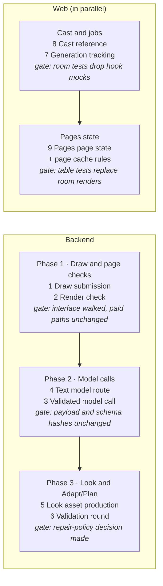

# Architecture deepening plan — October 16, 2026

**Status: Implemented and verified, October 19, 2026.** The
implementation record below describes the shared-checkout changes. The original
analysis and sequence follow as historical context; their line numbers refer to
`main` at `999b737b`.

## Implementation record

- Draw submission now owns preparation, quote, serialized admission, retry lineage
  and frozen execution. `PageDrawJob` owns scheduling, cancellation and failure
  policy. Render checks own immutable-render guards, evidence status and quotes
  for text, visual and change checks. Router-private test imports and the unused
  direct completion branch were removed.
- Text requests, normalized route results and paid lifecycle live in separate
  modules. `ValidatedCall` owns bounded attempts, checkpoint revalidation,
  observers and per-attempt telemetry; the existing structured-call interface
  uses that implementation too. Style, Plan and Adapt use explicit model jobs.
  Adapt's blueprint and lettering quotes apply the same current validators as
  their runs. Style records helper, failed-response and sibling usage.
- Look production owns reuse, held requests, prior image/sidecar archives,
  concurrency, descendant staleness (including props), and Character Check
  refresh. Style admission and durable jobs use `StageRuntime`.
- Validation rounds share the clean-candidate review guard, history and
  persistence. **Product decision, October 17:** preserve Adapt and Plan's
  distinct repair policies; no shared policy was imposed.
- The web track shares generation subject status/start, admission visibility,
  terminal states, style filtering, cache invalidation and credit recovery.
  Cast cards use one reference controller; page state and edition display
  images use one plain-data module. PagesRoom tests use the fetch seam, and the
  redundant Style generation store was removed.
- Provider-free fingerprints cover 52 model/wire combinations and nine stage
  request/schema cases captured from the pre-refactor source. Frozen page job
  serialization is checked through quote → submit → execute with fake adapters.

**Final verification:** the provider-free backend gate passed with 3,978 tests
passed and 64 skipped; Ruff is clean. The web suite passed 1,153 tests across
150 files; lint, build and the performance budget passed. Documentation references
were regenerated and the documentation reliability and diff checks passed.
Chromium-dependent local Finish export tests ran in the backend gate outside
the filesystem sandbox. No development servers or paid generation were started.
The changes remain uncommitted in the shared checkout.

Of the ten deepening candidates from the October 16 architecture review, one has landed and nine remain. Six of the nine are rated Strong. They run in three backend phases, with a web track alongside. Draw submission goes first because it sits in the two most-changed files: `page_drawing.py` and `server/routers/pages.py` account for 28 touches across the last 80 commits.

Each item turns a shallow cluster into one deep module: a small interface, the complexity behind it, and tests that cross that interface rather than private helpers. None of them reopens an ADR. Three also fix drift found along the way:

- estimates that disagree with runs;
- Look assets overwritten without saving a prior version;
- web job trackers that disagree on which job states are terminal.

## Done: adaptation shard plan

Adapt's provider-free shard algebra now lives in `adaptation_shards.py`: partition, scoped repair planning, and splicing back with a complete source ledger. The repair loop, resume and the cost estimate call `plan_repairs` and `splice_repairs` instead of each hand-chaining eight steps.

- **Verification:** the full provider-free backend gate passed: 3,858 tests, and Ruff is clean. The algebra tests moved to `tests/test_adaptation_shards.py`, which adds six interface tests.
- **Wire safety:** the draft schema classes keep their names (`_BookDraft`, `_LedgerException`). Their names appear in the provider JSON schema, and the schema hashes were identical before and after the move. Checkpoint and budget request hashes therefore do not change.

## Remaining improvements

| # | Deepened module | Problem today | Strength | Size |
| --- | --- | --- | --- | --- |
| 1 | Draw submission (quote · submit · execute) | Six copies of the prepare sequence, each resolving the Draw edition differently. Three copies of admission. The busy rule covers only corrections. | Strong | L |
| 2 | Render check (status · quote · run) | Whether a page render needs a paid read is decided three different ways, one of them the name of an `ArtifactMissing("raw_ocr")` exception. | Strong | M |
| 3 | Validated model call bound to a model job | Adapt, Plan and Style hand-roll nine call → validate → retry loops. Estimates disagree with runs. The feature-string prefix picks the reasoning effort. | Strong | L |
| 4 | Text model route split | `_chat_completion_once` is 480 lines and mixes payload shaping, three routes and billing. Codex and Claude fake chat completions to fit inside it. | Strong | M |
| 5 | Look asset production | About 12 copies of compile → reuse → hold → version → submit → stale. Plates, props and Style proofs are overwritten without saving a prior version. | Strong | M |
| 6 | Validation round for Adapt and Plan | Seven call sites must each remember the clean-candidate guard. The repair policy exists in three divergent forms. | Worth exploring | M |
| 7 | Web generation tracking | Seven trackers read one poll and disagree on terminal states and the current-style filter. The credits dialog is wired by hand at 21 call sites. | Strong | M |
| 8 | Web Cast reference | Three near-copy cards, about 574 lines. `useReferenceJob` returns raw setters, so every card must know the order to call them in. | Strong | S |
| 9 | Web Pages page state | Each page's state is derived inline from seven inputs. The rule that picks a page render's display image for its edition is written six times. | Worth exploring | S |

### 1. Draw submission

- **Files:**
  - `server/routers/pages.py` (232–295, 580–762, 1103–1376)
  - `server/page_operations.py`
  - `server/page_admission.py`
  - `server/job_execution.py`
  - `page_drawing.py` (1876–2290)
  - `stages/s7_page_draw.py`
  - `page_visual_review.py` (568–591)
- **Deepened module:** takes what the author asked for, against the page and render revision they saw, and offers quote and submit. The worker executes the queued command through the same module. The module hides:
  - the review gate;
  - Draw edition pinning;
  - lineage and staleness gates;
  - retry identity;
  - references and prepare;
  - the blob and job command;
  - a busy rule that covers every draw;
  - events and outcomes;
  - a typed page-draw job, which knows its lane, its cancel rule and its failure phase.
- **Seam:** the existing `CompletePageAdapter`, a real seam with five adapters, plus a ledger adapter with production and fake versions.
- **Tests:**
  - One suite drives quote → submit → execute with fakes.
  - Route tests check only HTTP mapping.
  - The 37 direct test calls into a completion branch production never takes go away.
  - No test imports router privates.

### 2. Render check

- **Files:**
  - `server/routers/pages.py` (158–229, 698–719, 773–915, 1407–1505)
  - `page_review.py` (451–586)
  - `page_drawing.py` (2010–2101, 2218–2263)
  - `server/generation_jobs.py` (543–551)
  - `models/draw.py` (700)
- **Deepened module:** owns three things for each page render:
  - its status: undrawn, stale_render, checked, cached_evidence, requires_ocr, or failed with a phase and message;
  - its quote;
  - a run step that takes allow-paid and an expected image digest.

  Text check, visual review and change check become kinds of check inside it.
- **Tests:** status-table tests over artifact fixtures with a fake reader. All four OCR commits this month had to teach the router new states.

### 3. Validated model call

- **Files:**
  - `clients/structured_call.py`
  - `clients/text.py`
  - `text_models.py` (150–173)
  - `book_adaptation.py`: the treatment, blueprint, lettering and draft loops, and the estimate at 2066–2208
  - `page_planning.py` (1217–1250, 1410–1437, 1685–1731)
  - `stages/s2_style.py`
  - `cast_design.py`
- **Deepened module:** a call bound to a model job, so the job, not a feature-string prefix, chooses model and effort. The module:
  - declares its retry policy and paid-call ceiling;
  - replays checkpoints and revalidates stale ones;
  - records usage through an observer;
  - emits per-attempt telemetry;
  - answers "is this call already paid for?", so estimates stop re-deriving checkpoint keys.
- **Drift it fixes:**
  - Adapt's estimate prices a faithful-brief resume as free while the run pays for a correction.
  - `style.direction_naming` silently never runs when the prompt job's effort is unsupported by the visual-review model.
  - Style drops usage, so Labs cost comparisons under-count.
- **Caveat:** Adapt's rule "reuse an interrupted repair batch, never a rejected one" depends on its named checkpoints.

### 4. Text model route

- **Files:**
  - `ai/client.py` (1678–2156)
  - `ai/codex_runtime.py`
  - `ai/claude_runtime.py`
  - `gemini_tuning.py`
  - `generation_checkpoints.py`
  - `generation_budget.py`
- **Deepened module:**
  - a per-`TextModel` request builder that applies tuning once, so hashes reuse the request actually sent;
  - route adapters (gateway, Codex, Claude) that return a normalized result with usage and ambiguity evidence;
  - one lifecycle module that mirrors the image side's `ai/finalisation.py`.
- **Tests:** payload-shape table tests with no HTTP and no event patches; lifecycle tests against a fake route.

### 5. Look asset production

- **Files:**
  - `stages/s3_cast.py` (456–493, 683–863, 866–1219)
  - `stages/s2_style.py` (1264–1303, 1789–1930)
  - `server/style_jobs.py` (65–182)
  - `asset_generation.py`
- **Deepened module:** one "produce Look asset" operation. It owns:
  - reuse;
  - held failures;
  - saving the prior version;
  - concurrency;
  - submission;
  - dependent staleness, props included;
  - the Character Check refresh.

  Stage loops and the four regenerate routes only list which assets to produce. Style's job path moves onto `StageRuntime`.
- **Clean-up:** remove the dead `kind` parameter (passed at 10 sites) and the five dead `last_attempt` unwraps.

### 6. Validation round

- **Files:**
  - `narrative_review.py` (595)
  - `book_adaptation.py`: the repair loop and the published re-review
  - `page_planning.py`: one-shot, page map, two-pass and `replan_page`
- **Deepened module:** owns:
  - reviewing only clean candidates;
  - merging review results;
  - attempt history;
  - repair eligibility;
  - persistence.

  Each stage supplies only how to find what to repair: shard scopes for Adapt, page spans for Plan.
- **Open decision:** should Adapt and Plan share one repair policy? Sharing one changes behaviour, so it is a product decision.

### 7. Web generation tracking

- **Files:**
  - `web/src/api/queries.ts` (406–423)
  - `hooks/useReferenceJob.ts`
  - `components/lettering/ProjectLetteringLanguage.tsx`
  - `pages/rooms/PagesRoom.tsx` (413–478, 590–617)
  - `api/pageRevisions.ts`
  - `pages/rooms/StyleRoom.tsx` with `store/styleGen.ts`
  - `pages/rooms/CastRoom.tsx`
  - `api/castReview.ts`
- **Deepened module:** two calls, `status(subject)` and `start(subject)`. It hides:
  - subject matching;
  - seeding from the admission response;
  - latest-wins;
  - the current-style filter;
  - one terminal set;
  - per-kind cache invalidation;
  - the credits dialog.
- **Tests:** one table test per job kind at the fetch seam. `pagesRoom.test.tsx` no longer mocks 23 query hooks.

### 8. Web Cast reference

- **Files:**
  - `web/src/pages/rooms/CastRoom.tsx` (252–307, 571–1144)
  - `api/queries.ts` (313–404)
  - `components/composites/CastRegenAction.tsx`
- **Deepened module:** one module for every kind: character, location, prop and appearance state. It returns:
  - the image state;
  - `regenerate`;
  - the error;
  - the estimate.

### 9. Web Pages page state

- **Files:**
  - `web/src/pages/rooms/PagesRoom.tsx`
  - `pages/rooms/BookRoom.tsx` (182)
  - `components/pages/PageSourcePanel.tsx` (103–106)
- **Deepened module:** a plain-data module beside `lib/stageQueue.ts`. It owns two rules:
  - the order of precedence among the inputs that set a page's state;
  - which image stands for a page render in its edition.

## Plan

1. **Phase 1: Draw and page checks.**
   - **Order:** Draw submission first. Render check follows and reuses Draw submission's active-render guard and credited-run step. Each starts with a design session on the interface.
   - **Done when:**
     - one quote → submit → execute suite runs with fake page and ledger adapters;
     - no test imports router privates;
     - the backend gate is green.
2. **Phase 2: Model calls.**
   - **Order:** the text model route split goes first. It is smaller, and it produces the single request builder that hashes reuse. The validated model call then sits on top of it, migrating Style, then Plan, then Adapt.
   - **Done when:**
     - schema and payload fingerprints are identical before and after;
     - estimates and runs agree on cached work;
     - Adapt and Plan emit per-attempt telemetry.
3. **Phase 3: Look and Adapt/Plan.**
   - **Order:** Look asset production first, because it fixes the missing prior versions. The validation round follows once the repair-policy decision is made.
   - **Done when:**
     - every Look asset keeps its prior version;
     - policy table tests replace the `review_narrative` monkeypatches.
4. **Web track, alongside phases 1 and 2.**
   - **Order:** Cast reference first: it is small and local to CastRoom. Generation tracking follows, then Pages page state with the cache-rule clean-up.
   - **Done when:**
     - there is one table test per job kind;
     - `pagesRoom.test.tsx` no longer mocks query hooks;
     - `npm test`, `npm run lint` and `npm run build` pass.

The backend and web tracks touch disjoint files, so they can run in two sessions at once. Within the backend, run one phase at a time, because phases 1 and 3 both touch generation code. Commit the shard refactor before starting.

## Guardrails and risks

- **Paid submissions:**
  - No automatic retries after ambiguous image submissions. The one exception is the approved single FAL attempt in `run_openai_first`.
  - One submit per action.
  - Frozen request provenance stays intact.
  - Editions never rebind and never change lettering mode.
- **Request hashes:** a refactor must not change provider-facing payloads or schema names. Fingerprint them before and after phases 1, 2 and the model-call work, as the shard move did.
- **Stage seams:** stages do not call one another, and validation stays with the stage that owns the artifact (ADR 0014). Each deepened module sits inside one stage or in server orchestration.
- **Replace, don't layer:** once the new interface has tests, delete the tests that reach into the old private functions.
- **Biggest risk:** phases 1 and 2 touch money paths. Each starts with an interface walkthrough and lands as its own change with the full backend gate.
- **Shared checkout:** parallel sessions touch disjoint files.

## Smaller seams, and what to leave alone

| Item | Note | Strength |
| --- | --- | --- |
| Draw edition profile registry | Lettering mode is stored twice: as a flag and as the `-integrated-v1`/`-hybrid-v1` suffix. Fold into phase 1. | Worth exploring |
| Protected passage obligations | Adapt re-anchors each phrase in six places, and two checks compare raw strings. | Worth exploring |
| Page-change cache rules (web) | The two copies of `invalidatePageReview` have diverged. Fold into the web track. | Worth exploring |
| Visual inventory locality | `approved_visual_inventory` lives in `stages/s5_plan.py` but serves eight modules. | Worth exploring |
| `RefStrategy` | A deletion candidate: `cast_style_ref` returns its argument unchanged, and three members have no callers. | Speculative |
| Labs arm retargeting | It has one adapter, so the seam is still hypothetical. | Speculative |

These modules are already deep. Extend them rather than re-inlining them.

Backend:

- `image_route_fallback.run_openai_first`
- `paid_shards`
- `generation_budget`
- `page_redraws`
- `page_outcomes`
- the `TargetArtifacts` generation journal
- `ImageProvider` with `ai/finalisation.py`
- `validate_book_adaptation` and `validate_book_plan`

Web:

- the `apiFetch` paid receipts
- `stageProgress`
- `useRunAction`
- `invalidateProject`
- `useStoryBibleMutation`
